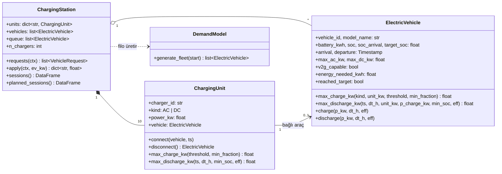

# Şarj istasyonu sınıf tasarımı (YM-2)

Durum: **Hafta 9 son hâli.** Hafta 2 tasarımı (`docs/raporlar/sinif-diyagrami.png`) aynı dört sınıfla başladı;
Hafta 3–8'de sözleşmedeki `requests/apply` arayüzüne göre yeniden düzenlendi. Kod: `src/microgrid/station/`.

## Sorumluluklar

| Sınıf / modül | Ne yapar |
| --- | --- |
| `ElectricVehicle` (`vehicle.py`) | Aracın kimliği, donanımı (batarya, OBC, V2G) ve durumu (SOC, bağlı olduğu ünite, aldığı/verdiği enerji). Şarj fiziği: `cc_cv_limit`, V2G garantileri. |
| `ChargingUnit` (`charging_unit.py`) | Tek AC/DC ünite; bağlı aracın o üniteden çekebileceği/verebileceği sınırı hesaplar. |
| `ChargingStation` (`charging_station.py`) | Döngünün gördüğü tek nesne. Her adım: ayrılanlar → gelenler sıraya → nöbetleşe şarj → boş üniteye atama (önce AC) → `VehicleRequest` listesi. `apply` güçleri kırpar ve uygular. |
| `DemandModel` (`demand_model.py`) | Config'teki dağılımlar ve araç kataloğundan bir günlük filo. |
| `strategies.py` | `uncontrolled`, `by_departure` (EMS için güç dağıtım kuralları), `satisfaction` (kullanıcı memnuniyeti KPI'ı). |
| `analysis.py` | Araç sayısı–tepe yük analizi, istasyonun kritik anı. |

## Hafta 2 tasarımından farklar

| Hafta 2 | Son hâl | Neden |
| --- | --- | --- |
| `bagli_araclar(saat)` → sözlük listesi | `requests(ctx)` → `VehicleRequest` | Ekip sözleşmesi (`docs/arayuz-sozlesmesi.md`) |
| `apply_power_allocations(dict)` → `None` | `apply(ctx, ev_kw)` → uygulanan güç | Döngü gerçekte uygulanan gücü kaydeder |
| Saatler ondalık (17.5) | `pd.Timestamp` (Europe/Istanbul) | Gece yarısını geçen kalışlar |
| `AC-01` | `AC1` | Sözleşmedeki biçim |
| Parametreler kodda | `config/default.yaml` | Ortak kural |
| `get_total_power_kw`, `get_dashboard_state` | `SimResult.steps.ev_kw`, `SimResult.station` | Toplam güç ve ünite görünümünü döngü kaydediyor |
| `UnitStatus`, ünite taban gücü (1,4 kW) | kaldırıldı | EMS'i karmaşıklaştırıyordu; sonuçlara etkisi yok |
| — | Sıra, nöbetleşe şarj, `sessions()`, `planned_sessions()` | 20 araç / 10 ünite, memnuniyet KPI'ı, MILP |
