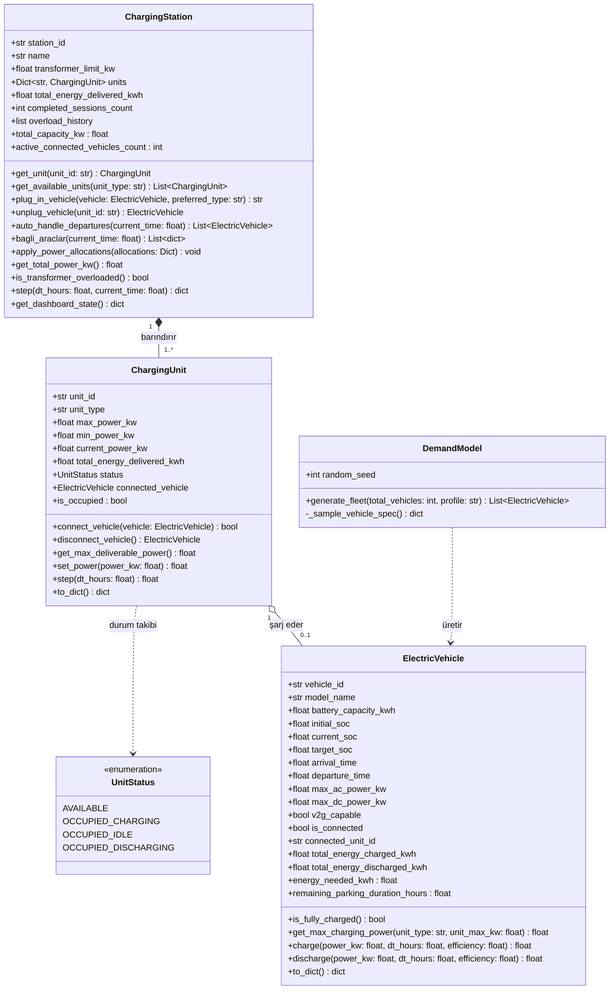

# EV ŞARJ İSTASYONU SINIF TASARIMI VE UML SINIF DİYAGRAMI
**Ders:** Akıllı Şebekeler Projesi  
**Rol:** YM-2 (Şarj İstasyonu Modeli)  
**Aşama:** Hafta 2 (Tasarım: Şema, Boyutlar ve Modül Arayüzleri)  

---

## 🖼️ Görsel Şema Çıktıları
- **Mermaid Şema Resmi (PNG):** [docs/mermaid-diagram-2026-10-16-140115.png](file:///Users/sude/Desktop/ak%C4%B1ll%C4%B1%20sebekeler%20proje/docs/mermaid-diagram-2026-10-16-140115.png) *(Mermaid Live Editor'dan alınan görsel şema)*
- **Alternatif UML Kutu Şeması (PNG):** [docs/sinif_diyagrami.png](file:///Users/sude/Desktop/ak%C4%B1ll%C4%B1%20sebekeler%20proje/docs/sinif_diyagrami.png) *(Klasik mühendislik UML diyagramı)*
- **İnteraktif Web Önizleme & SVG İndirici:** [docs/diagram_preview.html](file:///Users/sude/Desktop/ak%C4%B1ll%C4%B1%20sebekeler%20proje/docs/diagram_preview.html) *(Tarayıcınızda açıp tek tıkla vektörel SVG olarak indirebilirsiniz)*

---

## 🏛️ 1. Mimari Tasarım Prensipleri

Nesne yönelimli tasarımımız 3 temel katmandan ve sınıftan oluşur:

1. **`ElectricVehicle` (Araç Modeli):**
   - Tek bir elektrikli aracın fiziksel batarya özelliklerini, anlık şarj durumunu ($SOC$), şarj gereksinimini ve Li-ion CC-CV eğrisine göre maksimum çekebileceği gücü yönetir.
   - V2G (şebekeye enerji geri besleme) yeteneğini ve güvenlik eşiğini barındırır.
2. **`ChargingUnit` (Soket / Ünite Modeli):**
   - İstasyondaki her bir fiziksel şarj portunu (AC Tip-2 veya DC CCS2) temsil eder.
   - Soketin maksimum/minimum güç sınırlarını, anlık güç atamasını ve soket durumunu (`AVAILABLE`, `CHARGING`, `IDLE`, `DISCHARGING`) yönetir.
3. **`ChargingStation` (İstasyon Yönetim Modeli):**
   - Tüm şarj soketlerini bünyesinde toplar.
   - Yeni gelen araçları uygun boş soketlere bağlar (`plug_in_vehicle`), süresi dolan araçları ayırır (`auto_handle_departures`).
   - EMS'e bağlı araçların listesini döner (`bagli_araclar`), EMS güç atamalarını dağıtır (`apply_power_allocations`).
   - pandapower için anlık toplam istasyon yükünü (`get_total_power_kw`) ve trafo aşım durumunu hesaplar.

---

## 📊 2. UML Sınıf Diyagramı (Class Diagram)

---

## ⚙️ 3. Sınıf Alanları ve Metot Tanımları

### `ElectricVehicle`
- **`battery_capacity_kwh`**: Nominal batarya kapasitesi (kWh).
- **`current_soc`**: Anlık şarj durumu ($0.0 \le \text{SOC} \le 1.0$).
- **`target_soc`**: Kullanıcının ayrılırken beklediği hedef şarj ($0.85 - 1.00$).
- **`get_max_charging_power(unit_type, unit_max_kw)`**: 
  - Araç dahili OBC limiti (`max_ac_power_kw`), soket limiti (`unit_max_kw`) ve Li-ion CC-CV eğrisinin ortak kesişimindeki anlık çekilebilir tavan gücü hesaplar.
- **`charge(power_kw, dt_hours, efficiency)`**:
  - Bataryaya $\Delta E = P \times \Delta t \times \eta$ kadar net enerji aktarır ve SOC'yi günceller.

### `ChargingUnit`
- **`unit_id`**: Benzersiz soket kodu (`AC-01` ... `AC-08`, `DC-01`, `DC-02`).
- **`unit_type`**: `AC` (22 kW Tip-2) veya `DC` (50 kW CCS2).
- **`set_power(power_kw)`**:
  - EMS'ten gelen komutu soketin ve bağlı aracın fiziksel sınırlarıyla sınırlar. Negatif güç gelirse ve araç V2G yetenekliyse deşarj moduna geçer.
- **`step(dt_hours)`**:
  - Zaman adımını ilerleterek bağlı araca şarj uygular ve harcanan enerjiyi toplar.

### `ChargingStation`
- **`transformer_limit_kw`**: Şebeke / trafo bağlantı limiti (180 kW).
- **`bagli_araclar(current_time)`**:
  - EMS optimizasyon döngüsünün girdi alabilmesi için bağlı araçların aciliyet, SOC ve enerji gereksinimlerini liste olarak üretir.
- **`apply_power_allocations(allocations)`**:
  - EMS karar sözlüğünü soketlere paylaştırır.
- **`get_total_power_kw()`**:
  - Tüm soketlerin çektiği gücü toplayarak pandapower için anlık yük çıktısı verir.
