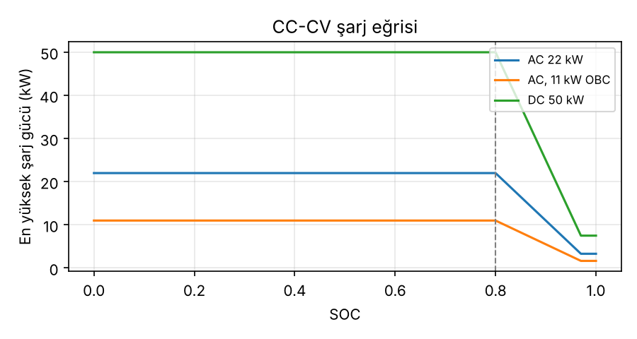
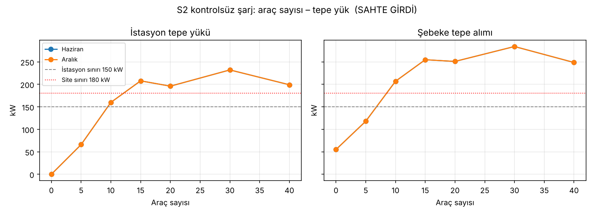
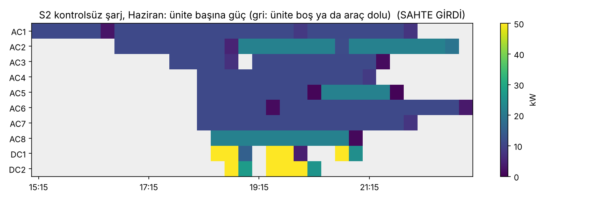
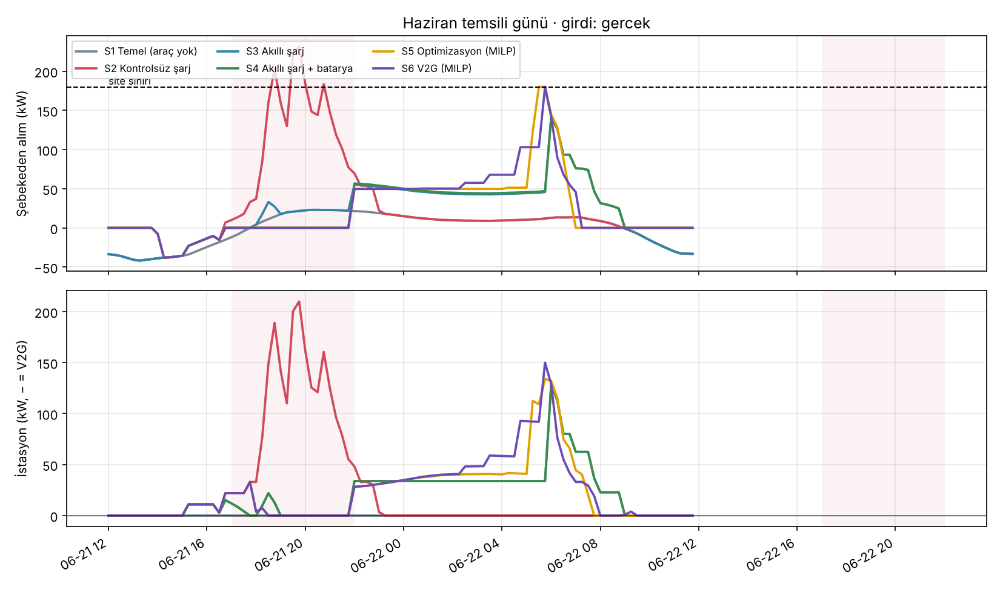
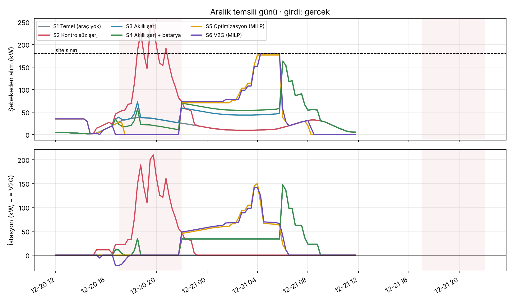

# Mikro-Şebeke Modellenmesi ve Analizi: Elektrikli Araç Şarj İstasyonu İçeren Sistem

Akıllı Şebekeler dersi dönem projesi · Sunum: 24 Aralık 2026

*Bu dosya `scripts/rapor_birlestir.py` ile üretildi (27.11.2026). Elle düzenlemeyin; her bölüm kendi dosyasında düzenlenir.*


# 1. Giriş

*Sorumlu: YM-4 (taslak)*

> Taslak (YM-4, Hafta 10). Ekip gözden geçirecek.

## Problem

Elektrikli araçların yaygınlaşmasıyla birlikte konutlarda ve otoparklarda şarj istasyonları kuruluyor. Bu istasyonlar
dağıtım şebekesi için büyük ve zamanlaması öngörülmesi zor bir yük. Bir site otoparkında araçların çoğu akşam eve
dönüşte, aynı saat aralığında takılıyor. Bu saat hem sitenin kendi tüketiminin hem de elektrik fiyatının (puant
tarife, 17–22) en yüksek olduğu saattir.

Projenin sorusu:

> Şarj istasyonu bu mikro-şebekeye ne yük getiriyor ve akıllı yönetimle bu yük ne kadar azaltılabiliyor?

## Kapsam

Bandırma'da 50 daireli bir siteyi temsil eden bir mikro-şebeke modellendi:

- **Sabit yük:** konutlar, ortak alan ve dükkânlar (yılda yaklaşık 200 MWh, araç şarjı hariç)
- **PV:** 100 kWp çatı sistemi
- **Batarya (BESS):** 200 kWh / 100 kW
- **Şarj istasyonu:** 8 × AC 22 kW ve 2 × DC 50 kW ünite, günde 20 araç; istasyon sınırı 150 kW
- **Şebeke bağlantısı:** 400 kVA trafo; site toplamı 180 kW ile sınırlı

İstasyon tipi olarak **site otoparkı** seçildi: araçlar akşam gelip sabah ayrıldığı için hem kontrolsüz şarjın
sorunu en net bu tipte görünür hem de akıllı şarjın yükü geceye kaydırabileceği uzun bir zaman penceresi vardır
(gerekçe: `docs/kapsam.md`). Fiziksel bir maket kurulmadı; bütün çalışma bilgisayar simülasyonudur.

## Yöntemin özeti

Çalışma iki katmanda yürütüldü:

1. **Zaman serisi simülasyonu (Python).** 15 dakikalık adımlarla bir temsili gün: gerçek güneş verisi (PVGIS),
   standart yük profilleri (BDEW) ve EPDK tarifesiyle. Her adımda şarj istasyonu modeli araçların isteklerini,
   enerji yönetim sistemi (EMS) kararları, pandapower da şebekenin gerilim ve yüklenmesini hesaplar. Altı senaryo
   karşılaştırıldı: araçsız temel durum, kontrolsüz şarj, kural tabanlı akıllı şarj, akıllı şarj + batarya,
   optimizasyon (MILP) ve araçtan şebekeye enerji (V2G).
2. **Dinamik analiz (MATLAB/Simulink).** MathWorks'ün *Microgrid with Electric Vehicles V2G Support* örneği temel
   alınarak saniyeler mertebesindeki frekans ve gerilim davranışı incelenir. Zaman serisi simülasyonu günün en zorlayıcı
   anını bulur; dinamik model o anı ayrıntılı inceler.

## Ekip ve bölümler

| Bölüm | Sorumlu |
| --- | --- |
| Veri ve yöntem (güneş, yük, tarife, KPI) | YM-1 |
| Şarj istasyonu modeli | YM-2 |
| Enerji yönetim sistemi ve optimizasyon | YM-3 |
| Entegrasyon, senaryo karşılaştırması, dashboard | YM-4 |
| Sistem tasarımı, şebeke ve dinamik analiz | EM-1, EM-2 |


# 2. Veri ve Yöntem

*Sorumlu: YM-1*

Bu bölüm, simülasyona giren zaman serilerinin (güneş üretimi, sabit yük, elektrik fiyatı) nereden geldiğini,
nasıl işlendiğini ve sonuçların nasıl değerlendirildiğini anlatır. Bütün sayılar `config/default.yaml` içinden
okunur; kod `src/microgrid/data/`, `src/microgrid/kpi.py` ve `src/microgrid/analysis.py` altındadır.

## 1. Konum ve sistem

Mikro-şebeke Bandırma'da (40,352° K, 27,977° D, rakım 43 m) 50 daireli bir siteyi temsil eder. Sitenin
otoparkında 8 × 22 kW AC ve 2 × 50 kW DC şarj ünitesi, çatıda 100 kWp güneş paneli (PV) ve 200 kWh / 100 kW
sabit batarya (BESS) bulunur. Elektrik ekibinin (EM-1) belirlediği üç sınır kullanılır: şarj istasyonu 150 kW,
sitenin şebekeden çekebileceği toplam güç 180 kW, trafo 400 kVA. Site otoparkı tipi seçilmiştir: araçlar akşam
eve dönüşte gelir (ortalama 18:30), sabah ayrılır.

## 2. Veri kaynakları

| Veri | Kaynak | Çözünürlük | Not |
| --- | --- | --- | --- |
| Güneş ışınımı ve PV üretimi | PVGIS v5.3 (AB Ortak Araştırma Merkezi) | saatlik, 2023 | Ücretsiz API, 1 kWp için |
| Sabit yük | BDEW standart yük profilleri (H0 konut, G0 ticari) | 15 dk → saatlik | `demandlib` paketi, Türkiye tatilleri |
| Elektrik fiyatı | EPDK tarife tablosu, 4 Nisan 2026 | dilim | Üç zamanlı mesken |
| EV şarj oturumları | Caltech ACN-Data | oturum | Erişim denendi; talep modeli YM-2'de |

### 2.1 Güneş verisi (PVGIS)

PVGIS'ten Bandırma için 2023 yılının saatlik verisi, 30° eğimli, güneye bakan, %14 sistem kayıplı 1 kWp'lik
bir sistem için indirilmiştir. Kurulu güce ölçekleme `pv_kw = kurulu güç × pv_kw_per_kwp` ile yapılır; böylece
PV gücü değiştiğinde veri yeniden indirilmez. PVGIS zamanları UTC'dir; Türkiye saatine (UTC+3) çevrilir ve
yıl başına kayan üç saat düzeltilir. Eksik, tekrar eden veya negatif değer bulunmamıştır (kontroller kodda durur).

Bandırma'da yıllık üretim **1332 kWh/kWp**'tir; 100 kWp için yaklaşık 133 MWh/yıl. Aylık üretim Temmuz'da en
yüksek (174 kWh/kWp), Ocak'ta en düşüktür (58 kWh/kWp).

**Doğrulama:** PVGIS sonucu, panel düzlemi ışınımı ve hava sıcaklığından basit bir fiziksel modelle
(NOCT 45 °C, güç sıcaklık katsayısı −%0,4/°C) bağımsız olarak yeniden hesaplanmıştır. Saatlik değerler
R² = 0,999 ile örtüşür, yıllık fark %3,5'tir.

### 2.2 Sabit yük (BDEW profilleri)

Site binalarının (daireler, ortak alanlar, küçük dükkânlar) tüketimi, Almanya'da saatlik sayacı olmayan aboneler
için kullanılan BDEW standart yük profillerinden üretilmiştir: konut için H0 (mevsime göre değişen dinamik katsayı
ile), ticari kısım için G0. Profiller hafta içi, cumartesi ve pazar ile kış, yaz ve geçiş dönemlerini ayırır.
Türkiye'nin resmî tatilleri (2023'te 13 gün) pazar gibi işlenir. Ölçek EM-1 kararıdır: 50 daire × 2400 kWh/yıl
(120 MWh) + ortak alan ve dükkânlar 80 MWh = **200 MWh/yıl** (araç şarjı hariç). Yılın tepe yükü yaklaşık 41 kW'tır.

### 2.3 Elektrik tarifesi (EPDK)

EPDK'nın 4 Nisan 2026'dan itibaren geçerli tablosunda AG tek terimli mesken (8 kWh/gün üstü) çok zamanlı tarifesi
kullanılmıştır. Vergiler hariç fiyat, aktif enerji bedeli ile dağıtım bedelinin (242,49 kr/kWh) toplamıdır:

| Dilim | Saat | TL/kWh |
| --- | --- | --- |
| Gündüz | 06–17 | 4,3755 |
| Puant | 17–22 | 6,1725 |
| Gece | 22–06 | 2,9386 |

Gece fiyatı puantın yarısından azdır; akıllı şarjın maliyet avantajı buradan gelir. Şebekeye satılan PV fazlası
bu aşamada ücretlendirilmemiştir.

## 3. Zaman çözünürlüğü

Simülasyon 15 dakikalık adımlarla çalışır; temsili gün öğlen 12:00'de başlar ve ertesi gün 12:00'de biter, böylece
akşam gelen aracın gece boyunca süren şarjı tek pencereye sığar. Saatlik veriler 15 dakikaya doğrusal ara
değerlemeyle çevrilir. Güç anlık bir büyüklük olduğu için bölünmez; her saatlik değer temsil ettiği ana yerleştirilir
(PV için PVGIS'in hesap anı olan saatin 10. dakikası, yük için saatlik ortalamanın merkezi olan 30. dakika).
Bu yöntemle günlük enerji %2'den az farkla korunur.

## 4. Temsili günler ve yıla genişletme

Pandapower yük akışıyla bir günlük simülasyon yaklaşık bir saniye sürdüğünden yıl, temsili günlerle özetlenmiştir:
4 mevsim (kış Ara–Şub, ilkbahar Mar–May, yaz Haz–Ağu, sonbahar Eyl–Kas) × 2 gün tipi (hafta içi; hafta sonu ve
resmî tatil) × 3 gökyüzü sınıfı = **24 temsili gün**. Gökyüzü sınıfı, her mevsim ve gün tipindeki günlerin
günlük PV enerjisine göre üç eşit gruba (bulutlu, orta, güneşli) bölünmesiyle elde edilir. Her temsili gün, gruptaki
günlerin saatlik ortalamasıdır ve yıllık sonuca gruptaki gün sayısıyla ağırlıklandırılarak katılır.

**Doğrulama:** Araçsız senaryo 365 günün tamamı için simüle edilmiş ve temsili gün tahminleriyle karşılaştırılmıştır.

| Temsili gün | Yıllık maliyet hatası |
| --- | --- |
| 8 (mevsim × gün tipi) | %−11,1 |
| 16 (+ güneşli / bulutlu) | %−4,6 |
| 24 (+ bulutlu / orta / güneşli) | **%−3,1** |

Gökyüzü ayrımı yapılmadığında güneşli günlerin PV fazlası ile bulutlu günlerin şebeke alımı ortalamada birbirini
götürür ve maliyet olduğundan düşük çıkar. 24 temsili gün bu hatayı üçte birine indirir. PV ve tüketimin yıllık
toplamı her durumda birebir korunur.

Bataryanın temsili günlerde bedava enerji kazanmaması için gün döngüsel çalıştırılır: her temsili gün, bataryanın
bir önceki çalıştırmada bittiği doluluk ile yeniden başlatılır (iki ısınma turu).

Kritik an tespiti için temsili günler ayrıca kullanılabilir: kontrolsüz şarjda (Senaryo 2) yılın en yüksek şebeke
yükü kışın bir hafta içi günü, 19:45 civarında oluşur (246 kW). Akıllı şarjda tepe gece ucuz tarife dilimine kayar.

## 5. Ertesi gün tahmini

Optimizasyonlu EMS (Senaryo 5) günü başında planlar. Plan gerçek değerlerle yapılırsa optimizasyonun başarısı
olduğundan iyi görünür; bu nedenle yalnızca geçmiş günlerin verisini kullanan gün öncesi tahminler hazırlanmıştır.
Yöntemler: dünün aynı saati (persistence), son 7 günün aynı saatteki ortalaması (climatology; yükte yalnızca aynı
gün tipinden) ve ikisinin karışımı (blend: %30 + %70). Yıl boyu karşılaştırmada seçilenler:

| Değişken | Yöntem | Saatlik hata (nMAE) | Günlük enerji hatası |
| --- | --- | --- | --- |
| PV | blend | kurulu gücün %5,1'i | 97 kWh/gün (ortalama üretim 365 kWh/gün) |
| Sabit yük | climatology | ortalama yükün %1,9'u | 10 kWh/gün |

PV hatası mevsime bağlıdır: Temmuz'da günde ~30 kWh, Aralık'ta günlük üretimin yaklaşık yarısı kadardır. Yük
tahmininin bu kadar iyi olması, yük verisinin standart bir profil olmasından kaynaklanır; gerçek sayaç verisinde
hata daha yüksek olur. Fiyat tarife olduğu için önceden bilinir.

## 6. Performans göstergeleri (KPI)

Bütün senaryolar aynı tanımlarla değerlendirilir (dt = adım süresi; işaret kuralında şebekeden alım pozitiftir):

| KPI | Tanım |
| --- | --- |
| Tepe yük | Şebekeden en yüksek alım (kW) ve zamanı |
| Maliyet | Σ max(şebeke, 0) × fiyat × dt (TL); alım gündüz / puant / gece dilimlerine ayrılır |
| Yenilenebilir payı | (PV − şebekeye veriş) / (sabit yük + araç şarjı) |
| Öz tüketim | (PV − şebekeye veriş) / PV |
| Araç şarjının puant payı | Puant dilimindeki şarj enerjisi / toplam şarj enerjisi |
| Sınır aşımı | 180 kW site ve 150 kW istasyon sınırının aşıldığı adım sayısı ve enerji |
| Gerilim ve yüklenme | En düşük bara gerilimi (p.u., sınır 0,95), en yüksek kablo ve trafo yüklenmesi (%) |

Batarya bir depo olduğu için tüketim sayılmaz; kayıpları şebeke alımına yansır.

## 7. Duyarlılık analizi

Araç sayısı (0–40), PV kurulu gücü (0–300 kWp) ve batarya kapasitesi (0–600 kWh) birer birer değiştirilip
her değer için yıllık KPI'lar 24 temsili günden hesaplanmıştır; diğer parametreler varsayılan değerlerinde tutulur.

## 8. Varsayımlar ve sınırlamalar

- Yük verisi ölçüm değil, Alman standart profilidir; Türkiye'deki yaz klima yükü ve günlük dalgalanma yoktur.
- Daire başına 2400 kWh/yıl bir başlangıç varsayımıdır.
- Hava verisi tek yıldır (2023); yıllar arası değişkenlik incelenmemiştir.
- Vergiler (KDV, BTV) maliyete katılmamıştır; senaryolar arası oranları değiştirmez.
- PV fazlasının şebekeye satışı ücretlendirilmemiştir.
- Temsili gün yöntemi yıllık maliyeti tam yıla göre ~%3 düşük tahmin eder; fark senaryoların hepsinde aynı yöndedir.

## Kaynaklar

- Huld, T., Müller, R., Gambardella, A. (2012). A new solar radiation database for estimating PV performance in
  Europe and Africa. *Solar Energy*, 86(6), 1803–1815. PVGIS: https://re.jrc.ec.europa.eu/pvg_tools/
- Meier, H., Fünfgeld, C., Adam, T., Schieferdecker, B. (1999). *Repräsentative VDEW-Lastprofile*. VDEW.
  Uygulama: oemof `demandlib`, https://github.com/oemof/demandlib
- EPDK (2026). 4 Nisan 2026 tarihinden itibaren geçerli vergiler hariç elektrik tarifeleri. https://www.epdk.gov.tr
- Lee, Z. J., Li, T., Low, S. H. (2019). ACN-Data: Analysis and Applications of an Open EV Charging Dataset.
  *Proceedings of the 10th ACM International Conference on Future Energy Systems (e-Energy '19)*, 139–149.


# 3. Şarj İstasyonu Modeli

*Sorumlu: YM-2*

> Taslak (Hafta 9). Sayıların hepsi `scripts/ym2_hafta5_tepe_yuk.py` ve `scripts/ym2_rapor_grafikleri.py`
> çıktısıdır; girdi gerçek veridir (PVGIS 2023 Bandırma, BDEW yük profilleri, EPDK tarifesi). Yeniden üretmek için:
> `python -m microgrid.data`, ardından iki betik.

## 1. İstasyonun tanımı

Site otoparkı (docs/kapsam.md): araçlar akşam eve dönüşte gelir, ertesi sabah ayrılır. Parametreler
`config/default.yaml` içindedir:

| Parametre | Değer | Kaynak |
| --- | --- | --- |
| Üniteler | 8 × AC 22 kW (Tip-2) + 2 × DC 50 kW (CCS2), kurulu 276 kW | EM-1, YM-2 |
| İstasyon güç sınırı | 150 kW | EM-1 |
| Site şebeke alım sınırı | 180 kW | EM-1 |
| Şarj verimi (şebeke → batarya) | 0,95 | YM-2 |
| CC-CV eşiği / taban | SOC 0,8 / anma gücünün %15'i | YM-2 |
| Araç sayısı | 20 | ekip kararı |
| V2G alt SOC | 0,3 | YM-2 |

## 2. Talep modeli

Her araç için (seed'li `numpy` üreteci, tekrar üretilebilir):

- Geliş saati ~ N(18,5; 1,5) sa, simülasyon başlangıcı (12:00) ile 12 saat sonrası arasına kırpılır.
- Ayrılış saati ertesi gün ~ N(7,5; 1,0) sa; en erken gelişten 1 saat sonra, en geç simülasyon sonunda.
- Geliş SOC ~ U(0,2; 0,6); hedef SOC 0,8.
- Araç modeli katalogdan payına göre seçilir:

| Model | Batarya (kWh) | AC/OBC (kW) | DC (kW) | V2G | Pay |
| --- | --- | --- | --- | --- | --- |
| Renault Zoe E-Tech | 52,0 | 22 | 50 | hayır | %25 |
| Tesla Model 3 SR+ | 60,0 | 11 | 170 | evet | %30 |
| Togg T10X Uzun Menzil | 88,5 | 22 | 150 | hayır | %25 |
| Hyundai Ioniq 5 | 77,4 | 11 | 220 | evet | %10 |
| Peugeot e-208 | 50,0 | 11 | 100 | hayır | %10 |

OBC (yerleşik şarj cihazı) sınırı önemlidir: filonun %50'si 22 kW AC ünitede yalnızca 11 kW çekebilir.

## 3. Ünite ataması, sıra ve nöbetleşe şarj

Her 15 dakikalık adımda istasyon sırasıyla: ayrılış saati gelen araçları üniteden çıkarır; yeni gelenleri FIFO
sıraya ekler; sırada bekleyen varsa hedef SOC'ye ulaşmış araçları üniteden alır (**nöbetleşe şarj**; araç
otoparkta kalır); sıranın başındakileri boş ünitelere bağlar (önce AC, AC kalmadıysa DC).

20 araç / 10 ünite olduğu için nöbetleşe şarj belirleyicidir. Kapalıyken araçların yarısı ünite bulmak için sabaha
kadar bekler (Tablo 2).

## 4. CC-CV şarj eğrisi



Ünitede çekilebilecek en yüksek güç önce donanımla sınırlanır: AC'de `min(OBC, ünite)`, DC'de `min(araç DC, ünite)`.
Sonra CC-CV uygulanır:

P(SOC) = P_anma, SOC < 0,8 iken; P(SOC) = P_anma · max(0,15; (1 − SOC) / 0,2), SOC ≥ 0,8 iken.

Hedef SOC 0,8 olduğu için varsayılan senaryolarda CV bölgesine girilmez. Hedef yükseltilirse (duyarlılık
analizi) gece sonu yükü uzar.

## 5. Döngüdeki yeri

```text
her adım:  vehicles = station.requests(ctx)          # bağlı araçlar ve sınırları (CC-CV, OBC, V2G)
           decision = ems.decide(...)                 # YM-3
           applied  = station.apply(ctx, decision.ev_kw)   # sınırlara kırp, SOC güncelle, uygulananı döndür
```

Güçler şebeke tarafıdır; bataryaya giren enerji güç × süre × 0,95. EMS 22 kW istese bile araç 2 kWh uzaktaysa
istasyon ancak o kadarını uygular; kayda giren her zaman uygulanan güçtür. Simülasyon sonunda araç başına oturum
tablosu (`SimResult.sessions`) çıkar: bekleme, alınan enerji, hedefe ulaştı mı.

## 6. V2G kuralı

V2G açıkken (`station.v2g_enabled`, Senaryo 6) V2G destekli araç her adımda şu sınırla deşarj edilebilir:

- SOC 0,3'ün altına inmez.
- Verilen enerji ayrılışa kadar geri doldurulabilmelidir. Bu adımdan sonra kalan süre t, tam şarj gücü p,
  verim η, batarya B için t · p · η ≥ (hedef − SOC) · B + E_çıkan olmalı, yani E_çıkan ≤ t · p · η − (hedef − SOC) · B.

Hedef CC-CV eşiğinin üstündeyse p olarak hedefteki (en düşük) CV gücü alınır; böylece yavaşlayan son kısım da
hesaba katılır. İstasyon bu iki koşulu uygular, yani deşarjdan sonra hedef her zaman *yetişilebilir* kalır; aracı
sonra tam güçle şarj etmek EMS'in işidir (deşarjdan sonra şarj etmeyen EMS'te araç hedefi kaçırır). İstasyon/site
güç sınırları bu hesapta yoktur. Test: 17–22 arası mümkün olan en fazla deşarjı, sonra tam şarjı isteyen bir EMS ile
20 araçta 58,8 kWh şebekeye verildi, bütün araçlar hedefe ulaştı; hedef 0,9–1,0 için de ayrı test var.

## 7. Sonuçlar (gerçek veri)



**Tablo 1. Kontrolsüz şarjda araç sayısına göre tepe yük (S2).**

| Araç | İstasyon tepe (kW) | Saat | Şebeke tepe, Haziran (kW) | Şebeke tepe, Aralık (kW) | 180 kW aşılan adım (Haz / Ara) |
| --- | --- | --- | --- | --- | --- |
| 0 | 0 | — | 23 | 38 | 0 / 0 |
| 5 | 66 | 19:15 | 88 | 103 | 0 / 0 |
| 10 | 160 | 19:30 | 181 | 197 | 1 / 2 |
| 15 | 210 | 19:30 | 231 | 247 | 4 / 5 |
| 20 | 210 | 19:45 | 232 | 246 | 5 / 6 |
| 30 | 232 | 20:15 | 255 | 265 | 13 / 13 |
| 40 | 222 | 20:45 | 244 | 253 | 18 / 21 |

10 araçtan itibaren istasyon 150 kW sınırını, site 180 kW sınırını aşıyor. 15 araçtan sonra tepe pek artmıyor
çünkü 10 ünitenin hepsi zaten dolu: tepeyi araç sayısı değil ünite sayısı belirliyor; araç sayısı arttıkça tepe
yükselmek yerine akşama yayılıyor (aşılan adım sayısı artıyor). İstasyon yükü Haziran ve Aralık'ta aynı, çünkü
araçların geliş dağılımı mevsime bağlı değil; aradaki fark sabit yükten geliyor (Aralık'ta akşam ~15 kW daha yüksek).

Kontrolsüz şarjda (20 araç) istasyonun en yüklü anı 19:45: 210 kW, 8 AC + 2 DC ünitenin hepsi şarj ediyor, bağlı
araçların ortalama SOC'si 0,53. Simulink D2 senaryosu (toplu araç bağlanması) bu değerlerle kurulabilir.



**Tablo 2. Kullanıcı memnuniyeti, Haziran** (`ym2-memnuniyet.md`).

| | S2 kontrolsüz | S3 akıllı (geçici) | S2, nöbetleşe kapalı |
| --- | --- | --- | --- |
| Hedefe ulaşma oranı | 1,00 | 0,80 | 0,50 |
| Hizmet alamayan araç | 0 | 0 | 5 |
| Ortalama eksik enerji (kWh) | 0,0 | 5,2 | 10,5 |
| Ortalama bekleme (sa) | 0,2 | 4,7 | 5,7 |
| İstasyon tepe (kW) | 210 | 150 | 177 |

Kontrolsüz şarj şebekeye kötü (tepe 210 kW), kullanıcıya iyidir (herkes dolar). Şarjı bütün geceye yayan akıllı
şarj tepeyi 150 kW'a (istasyon sınırı) indiriyor ama üniteleri uzun süre tuttuğu için araçların %20'si hedefe yetişemiyor.
Ünite sayısı sınırlıyken iyi bir EMS hem tepeyi hem üniteyi yönetmeli. YM-3'ün EMS sonuçları gelince bu tablo
S3–S6 ile güncellenecek.

## 8. Sınırlamalar

- Talep modeli sentetik (normal/uniform dağılımlar); ACN-Data ile kalibre edilmedi.
- Optimizasyon için gün başında araçların geliş bilgisinin bilindiği varsayıldı (kusursuz bilgi).
- Planlama tüm araçların AC ünitede şarj olacağını varsayar; DC ünite yalnızca AC dolunca kullanılır.
- OBC çift yönlü kabul edildi (AC V2G'de deşarj sınırı OBC gücü).
- Tek temsili gün; araçlar her gün aynı dağılımdan gelir.


# 4. Enerji Yönetim Sistemi ve Optimizasyon

*Sorumlu: YM-3*

> **Editör notu (YM-4):** Bu bölümdeki sayılar YM-2'nin istasyon modeli birleşmeden önce, sahte istasyonla (CC-CV ve ünite paylaşımı yok) üretildi. Gerçek istasyonla güncel karşılaştırma *Entegrasyon ve Senaryo Karşılaştırması* bölümündedir; rapor teslim edilmeden önce bu bölümün sayıları onunla uyumlu hâle getirilmelidir.

Rapora girecek bölüm. Sayıların kaynağı: [hafta9-ym3-ems-optimizasyon.md](hafta9-ym3-ems-optimizasyon.md) (`scripts/ym3_hafta9_sonuclar.py`).

## 1. Amaç

Projenin sorusu: şarj istasyonu mikro-şebekeye ne yük getiriyor ve akıllı yönetimle bu yük ne kadar azaltılabiliyor? Enerji yönetim
sistemi (EMS) bu sorunun "akıllı yönetim" tarafıdır. Her 15 dakikada iki karar verir: her araca kaç kW verilecek (V2G'de negatif) ve
bataryanın gücü ne olacak. Şebeke gücü bir karar değil, güç dengesinin sonucudur:
`grid = sabit yük + araçlar + batarya − PV`.

## 2. Yöntem

Aynı arayüze (`prepare`, `decide`) takılan üç EMS karşılaştırıldı.

**Kontrolsüz (S2).** Araç bağlandığı an ünitenin tam gücüyle şarj olur. Bu, sorunun görüldüğü referanstır.

**Kural tabanlı (S3, S4).** Her araç için ayrılışa kadarki pencerede en ucuz tarife adımları seçilir ve ihtiyaç bu adımlara
*eşit* yayılır. Tam güçle başlatmak, tüm araçların gece diliminin ilk adımında aynı anda şarja geçip 22:00'de yeni bir tepe
yaratmasına yol açar; eşit yayma bunu önler. SOC eşiği: 0.30 altındaki araç tarifeden bağımsız şarj edilir. PV fazlası ücretsiz
olduğu için araçlara verilir. Toplam, istasyon (150 kW) ve site (180 kW) sınırlarıyla kısılır. Bataryada öncelik sırası: site sınırı,
PV fazlası, puantta deşarj, gece ucuz tarifeyle şarj.

**Optimizasyon (S5, S6).** Kayan ufuklu karma tamsayılı doğrusal program (PuLP, CBC çözücüsü). Her adımda bağlı araçlar için bu
adımdan günün sonuna kadar çözülür, yalnızca ilk adım uygulanır. Gün başında tek çözüm yapılamaz: araçların geliş saati, SOC'si ve
ayrılışı o an bilinmiyor.

Amaç (TL), $t$ adımları, $\Delta t$ = 0.25 saat:

$$\min \sum_t \pi_t\, P^{\mathrm{imp}}_t \Delta t \;+\; w_{\mathrm{peak}}\, P^{\mathrm{peak}} \;+\; c_{\mathrm{bess}} \sum_t P^{\mathrm{dis}}_t \Delta t \;+\; c_{\mathrm{v2g}} \sum_{v,t} P^{\mathrm{v2g}}_{v,t} \Delta t \;+\; \text{ceza}$$

Kısıtlar:

| Kısıt | İfade |
| --- | --- |
| Güç dengesi | $P^{\mathrm{imp}}_t - P^{\mathrm{exp}}_t = P^{\mathrm{yük}}_t + \sum_v (P^{\mathrm{ch}}_{v,t} - P^{\mathrm{v2g}}_{v,t}) + P^{\mathrm{bch}}_t - P^{\mathrm{bdis}}_t - P^{\mathrm{pv}}_t$ |
| Site sınırı | $P^{\mathrm{imp}}_t \le 180$ kW (cezalı gevşeme) |
| İstasyon sınırı | $\sum_v (P^{\mathrm{ch}}_{v,t} - P^{\mathrm{v2g}}_{v,t}) \le 150$ kW |
| Batarya | $E_{t+1} = E_t + (\eta P^{\mathrm{bch}}_t - P^{\mathrm{bdis}}_t/\eta)\Delta t$, SOC bandı $[0.1, 0.9]$, günün sonunda SOC $\ge$ başlangıç |
| Araç hedefi | ayrılışta SOC $\ge$ 0.80 (cezalı gevşeme) |
| V2G | araç SOC'si $\ge$ 0.30; aynı adımda hem şarj hem deşarj yok (ikili değişken) |

Tepe terimi $w_{\mathrm{peak}}$ = 0.2 TL/kW küçüktür; maliyeti aynı olan çözümler arasında düz olanı seçtirir.

## 3. Bulgular (Aralık hafta içi, 5 araç filosu ortalaması)

| Senaryo | Maliyet (TL) | Tepe alım (kW) | Puant şarj payı |
| --- | ---: | ---: | ---: |
| S2 Kontrolsüz | 3696 | 208 | 0.59 |
| S3 Akıllı şarj (kural) | 3076 (−17%) | 107 (−49%) | 0.01 |
| S4 + batarya (kural) | 2854 (−23%) | 107 (−49%) | 0.01 |
| S5 MILP | 2656 (−28%) | 67 (−68%) | 0.00 |
| S6 V2G (MILP) | 2633 (−29%) | 68 (−67%) | 0.00 |

1. Şarj saatini kaydırmak tek başına tepe yükü yarıya indirir. Bu, bataryasız ve yatırım gerektirmeyen çözümdür.
2. Batarya yazın (PV fazlası) kışa göre daha değerlidir: Haziran'da S3 → S4 maliyette −%26, Aralık'ta −%7.
3. Optimizasyon kural tabanlıya göre tepede %36–37, maliyette %7–15 daha iyi. Fark, bataryanın tarife farkından (gündüz 4.38, puant
   6.17 TL) yararlanmasından ve araç şarjıyla birlikte planlanmasından geliyor.
4. V2G bu sitede kazancı çok az artırıyor (−%1 ila −%3.5): araçlar akşam düşük SOC'yle geliyor ve sabah dolu ayrılmak zorunda.
   Aşınma bedeli 4 TL/kWh olursa V2G tamamen kapanıyor.

## 4. Tartışma ve sınırlar

- **Tahmin hatası.** Gerçek tarihli bir günde (20 Aralık) YM-1'in tahminiyle MILP kusursuz bilgiye göre %5.5 pahalı (2381 → 2512 TL) ve
  kural tabanlı S4 ile (2502 TL) maliyette pratik olarak başa baş. Tepe avantajı kalıyor (66 ve 107 kW). Tek gün; genelleme yapılmamalı.
- **İstasyon modeli.** Sonuçlar sahte istasyonla (CC-CV ve ünite paylaşımı yok) üretildi. YM-2'nin istasyonu eklenince yeniden
  çalıştırılacak; senaryoda tek satır (`station=`).
- **Varsayımlar.** Şebekeye satış ücretsiz; V2G araçların %40'ı, 11 kW, verim 0.95; V2G aşınması 0.5 TL/kWh (ölçüm değil, varsayım);
  yük profili BDEW standardı.
- **Yöntem sınırı.** Kayan ufuk gelecekteki araç gelişlerini bilmiyor; bu yüzden yeni gelen araçlar planı değiştirebiliyor. İleride
  gelişler için olasılıksal bir model eklenirse plan daha iyi olabilir.
- **PuLP sürümü.** PuLP 4 CBC'yi içermiyor ve API'yi değiştirdi; proje `pulp<4` kullanıyor.

## 5. "Hazır örnekten farkınız ne?" (EMS tarafı için cevap)

MathWorks V2G örneği saniyeler mertebesinde dinamik davranışı (frekans, gerilim) gösterir; bir günün enerji yönetimini yapmaz.
Bizim katkımız gün ölçeğinde bir karar katmanı: gerçek PV, yük ve tarife verisiyle, istasyon ve site sınırlarına uyarak araç şarjını ve bataryayı
planlıyor ve bu kararların tepe yüke, maliyete ve kullanıcı memnuniyetine (hedef SOC) etkisini ölçüyor. Simulink tarafı (EM-1, EM-2)
bu planın dinamik olarak kararlı olup olmadığını gösteriyor; iki katman birbirini tamamlıyor.


# 5. Sistem Tasarımı, Şebeke ve Dinamik Analiz

*Sorumlu: EM-1, EM-2*

## 1. Onaylanan Şebeke Parametreleri
- **OG / AG Trafo:** 400 kVA, 20/0,4 kV
- **Site Kablosu:** NAYY 4x150 SE, 150 m (Site Barası: Sabit yük ~200 MWh/yıl + 100 kWp PV)
- **Otopark Kablosu:** NAYY 4x150 SE, 100 m, taşıma kapasitesi ~270 A (Otopark Barası: 200 kWh / 100 kW BESS, SOC %10–90 + 276 kW kurulu / 150 kW sınırlı şarj istasyonu)
- **Gerilim Sınırı:** 0,95–1,05 p.u.

## 2. Statik Yük Akışı Doğrulaması (pandapower — EM-2)
- **S2 (Kontrolsüz Şarj, 210 kW):** Otopark kablosu akımı ~315 A (%117 aşırı yüklenme), en düşük bara gerilimi 0,961 p.u. (sınır içinde).
- **Sınırlı Çalışma (150 kW istasyon sınırı):** Kablo yüklenmesi %80–84 aralığında güvenli bölgede kalır.

## 3. Dinamik Analiz Senaryoları (MATLAB/Simulink — EM-1)
Ortak CSV sütun formatı: `time_s, freq_pu, v_pcc_pu, p_grid_kw`

- **D1 (`D1_yuk_basamagi.csv`):** Eklenecek
- **D2 (`D2_toplu_baglanma.csv`):** Eklenecek
- **D3 (`D3_pv_dususu.csv`):** Eklenecek
- **D4 (`D4_ada_modu.csv`):** Eklenecek


# 6. Entegrasyon ve Senaryo Karşılaştırması

*Sorumlu: YM-4*

Bu bölüm modüllerin tek bir simülasyonda nasıl birleştiğini, sonuçların nasıl üretildiğini ve altı senaryonun
gerçek veriyle karşılaştırmasını anlatır. Veri (YM-1), istasyon (YM-2) ve EMS (YM-3) modellerinin ayrıntıları kendi
bölümlerindedir.

## 1. Mimari

Simülasyon 15 dakikalık adımlarla, öğlen 12:00'de başlayıp ertesi gün 12:00'de biten bir temsili gün boyunca
(96 adım) ilerler. Her adımda döngü modülleri sabit bir sırayla çağırır:

1. **İstasyon (YM-2)** ayrılan araçları çıkarır, gelenleri sıraya alır, boş ünitelere bağlar ve bağlı her aracın
   o adımdaki sınırlarını bildirir (`requests`: SOC, hedef, ayrılış saati, en yüksek şarj/deşarj gücü, CC-CV dahil).
2. **EMS (YM-3)** PV, sabit yük, tarife ve araç isteklerine bakıp araç başına güç ve batarya gücüne karar verir (`decide`).
3. İstasyon kararı ünite ve araç sınırlarına göre uygular, SOC'leri günceller (`apply`); batarya da kendi sınırlarını uygular.
4. **Güç dengesi:** `şebeke = sabit yük + istasyon + batarya − PV`.
5. **Şebeke (pandapower)** yük akışını çözer: bara gerilimleri, kablo ve trafo yüklenmesi.

Modüller birbirini doğrudan çağırmaz; yalnızca `src/microgrid/interfaces.py`'deki veri tiplerini (`VehicleRequest`,
`EmsInputs`, `Decision`) kullanır. Bu sözleşme 2. haftada yazıldı. Böylece her modül ötekiler hazır olmadan sahte
(mock) karşılıklarıyla geliştirilip test edilebildi; gerçek modüller geldikçe senaryo tanımında tek satır değişti
(`src/microgrid/sim/scenarios.py`).

## 2. Senaryolar

Altı senaryonun hepsinde istasyon aynıdır: site otoparkı, 20 araç, 8 × AC 22 kW + 2 × DC 50 kW ünite, istasyon
sınırı 150 kW, sitenin şebekeden çekebileceği en yüksek güç 180 kW.

| | Senaryo | Yönetim |
| --- | --- | --- |
| S1 | Temel | Araç yok (karşılaştırma tabanı) |
| S2 | Kontrolsüz şarj | Araç geldiği an tam güçle şarj olur |
| S3 | Akıllı şarj | Kural tabanlı: şarj ayrılışa kadarki en ucuz tarife adımlarına yayılır |
| S4 | Akıllı şarj + batarya | S3 + 200 kWh / 100 kW batarya |
| S5 | Optimizasyon | Kayan ufuklu MILP: en düşük maliyet |
| S6 | V2G | S5 + araçtan şebekeye deşarj |

## 3. Sonuçların üretimi ve doğrulama

- **Tek kaynak.** Bütün tablolar `python -m microgrid.sim.sonuclar` ile üretilir. Komut altı senaryoyu iki temsili
  günde, aynı girdilerle ve yük akışıyla çalıştırır. Dashboard aynı fonksiyonları kullandığı için ekranda görünen
  sayılarla rapordaki sayılar aynıdır.
- **Tekrarlanabilirlik.** Rapordaki sayılar GitHub Actions'ta (`sonuclar` iş akışı) temiz bir ortamda, PVGIS
  verisi indirilerek üretildi. Herkes aynı sürümlerle aynı sonucu alır. Araç gelişleri sabit tohumla üretildiği için
  aynı gün her çalıştırmada aynıdır.
- **Testler.** Her PR'da 240'ı aşkın birim testi çalışır; bunlar her adımda güç dengesini, batarya ve araç SOC
  sınırlarını, istasyon ve site sınırlarını ve dashboard'un her senaryoda hatasız açıldığını kontrol eder.

## 4. Sonuçlar

Girdi: Bandırma PVGIS (2023), BDEW yük profilleri, EPDK üç zamanlı tarife (Veri ve Yöntem bölümü). Kaynak:
`sonuclar` iş akışı, 26.11.2026.

**Tablo 4.1. Haziran temsili günü (gerçek veri).**

| Gösterge | S1 | S2 | S3 | S4 | S5 | S6 |
| :-------------------------------- | -----: | -----: | -----: | -----: | -----: | -----: |
| Şebeke tepe alımı (kW) | 23 | 232 | 141 | 141 | 180 | 180 |
| Tepe saati | 20:30 | 19:45 | 06:00 | 06:00 | 05:45 | 05:45 |
| Puant (17–22) tepe alımı (kW) | 23 | 232 | 33 | 0 | 0 | 0 |
| Günlük maliyet (TL) | 892 | 4.262 | 2.541 | 2.044 | 1.861 | 1.951 |
| Araçlara verilen enerji (kWh) | 0 | 590 | 486 | 486 | 529 | 562 |
| Hedef SOC'ye ulaşan araç | — | %100 | %80 | %80 | %90 | %95 |
| Ortalama ünite beklemesi (sa) | — | 0,2 | 4,7 | 4,7 | 4,4 | 4,0 |
| V2G ile şebekeye (kWh) | 0 | 0 | 0 | 0 | 0 | 0 |
| Site sınırı aşılan adım | 0 | 5 | 0 | 0 | 0 | 0 |
| En düşük gerilim (p.u.) | 0,993 | 0,961 | 0,977 | 0,977 | 0,970 | 0,970 |
| Trafo en yüksek yüklenme (%) | 11 | 60 | 36 | 36 | 47 | 47 |

**Tablo 4.2. Aralık temsili günü (gerçek veri).**

| Gösterge | S1 | S2 | S3 | S4 | S5 | S6 |
| :-------------------------------- | -----: | -----: | -----: | -----: | -----: | -----: |
| Şebeke tepe alımı (kW) | 38 | 246 | 163 | 163 | 177 | 180 |
| Tepe saati | 18:30 | 19:45 | 06:00 | 06:00 | 05:30 | 05:00 |
| Puant (17–22) tepe alımı (kW) | 38 | 246 | 72 | 57 | 28 | 0 |
| Günlük maliyet (TL) | 2.045 | 5.532 | 3.808 | 3.586 | 3.332 | 3.283 |
| Araçlara verilen enerji (kWh) | 0 | 590 | 486 | 486 | 573 | 590 |
| Hedef SOC'ye ulaşan araç | — | %100 | %80 | %80 | %90 | %90 |
| Ortalama ünite beklemesi (sa) | — | 0,2 | 5,2 | 5,2 | 3,9 | 3,9 |
| V2G ile şebekeye (kWh) | 0 | 0 | 0 | 0 | 0 | 21 |
| Site sınırı aşılan adım | 0 | 6 | 0 | 0 | 0 | 0 |
| En düşük gerilim (p.u.) | 0,988 | 0,960 | 0,973 | 0,973 | 0,970 | 0,969 |
| Trafo en yüksek yüklenme (%) | 10 | 64 | 42 | 42 | 46 | 47 |





## 5. Bulgular

**5.1 Kontrolsüz şarj şebekeyi sınırın ötesine taşıyor.** Araçlar eve dönüş saatinde geldiği için istasyon yükü
puant tarifesine (17–22) ve sitenin akşam tüketimine denk geliyor. Şebeke alımı araçsız güne göre 10 kat artıyor
(Haziran 23 → 232 kW), site sınırı (180 kW) Haziran'da 5, Aralık'ta 6 adım (1,25–1,5 saat) aşılıyor. Araç şarjının
%90'ı en pahalı tarife diliminde. En düşük gerilim 0,96 p.u.'ya, trafo yüklenmesi %60–64'e çıkıyor. Gerilim sınırın
(0,95) içinde kalıyor, ama asıl kısıt güç sınırı.

**5.2 Akıllı şarj akşam tepesini ortadan kaldırıyor.** Puant tepe alımı S3'te 232'den 33 kW'a (Haziran, −%86),
246'dan 72 kW'a (Aralık, −%71) iniyor; S4–S6'da puantta araç şarjı neredeyse hiç kalmıyor. Site sınırı hiçbir akıllı
senaryoda aşılmıyor.

**5.3 Maliyetler aynı enerji üzerinden karşılaştırılmalı.** S3 ve S4 araçlara 590 yerine 486 kWh veriyor (araçların
%20'si hedefe ulaşamıyor); S5 ve S6 da hedefi %90–95 karşılıyor. Ham günlük maliyet bu yüzden akıllı şarjı
olduğundan daha iyi gösterir. Adil karşılaştırma için araçların siteye getirdiği ek maliyeti (S1'e göre) verilen
enerjiye böldük:

| | S2 | S3 | S4 | S5 | S6 |
| --- | ---: | ---: | ---: | ---: | ---: |
| Haziran, TL/kWh | 5,71 | 3,39 | 2,37 | 1,83 | 1,88 |
| Aralık, TL/kWh | 5,91 | 3,63 | 3,17 | 2,25 | 2,10 |

Bu ölçüte göre de kWh başına maliyet kontrolsüz şarja göre yarıdan fazla düşüyor. Ama düşüşün bir kısmı daha az
enerji verilmesinden geliyor; bunu "kullanıcıya hizmet" ölçütleriyle birlikte okumak gerekir. S4–S6'da bataryanın sabit
yük maliyetine etkisi de bu sayının içinde.

**5.4 Tepe yok olmuyor, gece tarifesinin bitişine kayıyor.** Akıllı senaryoların en yüksek alımı akşam değil
sabah: S3/S4'te 06:00'da (141–163 kW), S5/S6'da 05:00–05:45'te ve site sınırına dayanarak (177–180 kW). Gece tarifesi
06:00'da bittiği için maliyeti en aza indiren kural ya da optimizasyon kalan şarjı bu saatten hemen önceye topluyor.
Aynı etkiyi 6. haftada basit bir zaman kaydırma kuralında da gördük: herkes 22:00'de şarja başlayınca 180 kW'lık yeni
bir tepe oluşmuştu. **Sonuç: maliyeti en aza indirmek ile tepeyi en aza indirmek aynı hedef değil.** MILP tepeyi
düşürsün diye amaç fonksiyonundaki tepe ağırlığı artırılabilir, ya da sabah için ayrı bir güç sınırı konabilir.

**5.5 Batarya yazın değerli.** S4'te batarya Haziran'da puant alımını sıfırlıyor ve maliyeti S3'e göre %20
düşürüyor; Aralık'ta düşüş %6. Yazın gündüz PV fazlası bataryayı dolduruyor, kışın bu fazla yok (Aralık'ta PV'nin
tamamı sitede tüketiliyor).

**5.6 V2G bu sitede küçük.** Araçlar akşam düşük SOC'yle gelip sabah dolu ayrılmak zorunda olduğu için şebekeye
verebilecekleri enerji az: Haziran'da hiç, Aralık'ta 21 kWh. Bu, YM-3'ün sahte istasyonla bulduğu sonuçla uyumlu.

**5.7 Kullanıcı tarafında bedel: ünite beklemesi.** 20 araca 10 ünite var. Kontrolsüz şarjda araçlar çabuk dolup
üniteyi bıraktığı için ortalama bekleme 0,2 saat. Akıllı senaryolarda şarj geceye yayıldığından üniteler sabaha kadar
dolu kalıyor; bekleme 4–5 saate çıkıyor ve bazı araçlar hedefe yetişemiyor. İyi bir EMS yalnızca gücü değil ünite
sırasını da yönetmeli.

## 6. Entegrasyonda bulunan hatalar

Modüller ayrı ayrı testlerden geçiyordu; aşağıdaki hatalar ancak birlikte çalıştırılınca görüldü:

| Hata | Etkisi | Çözüm |
| --- | --- | --- |
| Kural tabanlı EMS istasyonun %95 şarj verimini hesaba katmıyordu (sahte istasyon kayıpsızdı) | S3'te araçların yalnızca %55'i hedefe ulaşıyordu; maliyet yanıltıcı biçimde düşük görünüyordu | İhtiyaç şebeke tarafında, verime bölünerek planlandı (MILP'deki gibi). Hedefe ulaşma %80'e çıktı |
| KPI modülü MILP'in çözücü toleransını (~0,0000005 kW) sınır aşımı sayıyordu | S5'te 3 adım hayalî "site sınırı aşımı" | Aşım eşiği 1 W yapıldı |
| YM-3'ün sonuçları sahte istasyonla üretilmişti | S5 tepe alımı 67 kW görünüyordu; gerçek istasyonla 177–180 kW | Bütün sonuçlar gerçek istasyonla yeniden üretildi (bu bölümdeki tablolar) |

## 7. Sınırlamalar

- Her mevsim için tek bir temsili gün ve tek bir araç gelişi örneği kullanıldı; günden güne değişkenlik yok.
- MILP gün başında araçların ne zaman geleceğini bilmiyor (kayan ufuk), ama bağlı araçların ayrılış saatini biliyor.
- Hedef SOC MILP'te kesin değil, cezalı bir kısıt: optimizasyon bazı araçları hedefin biraz altında bırakabiliyor
  (S5'te %90).
- Kontrolsüz şarjda istasyonun 150 kW sınırı uygulanmıyor (sınırı uygulayacak bir yönetim yok); S2'deki aşım bu
  varsayımın sonucu.
- Simulink dinamik sonuçları (D1–D4) bu bölümde yok.


# 7. Sonuç

*Sorumlu: YM-4 (taslak)*

> Taslak (YM-4, Hafta 10). Sayılar Entegrasyon bölümündeki gerçek veri tablolarındandır. Ekip gözden geçirecek.

**Şarj istasyonu bu mikro-şebekeye ne yük getiriyor?** Kontrolsüz şarjda 20 aracın istasyonu, sitenin şebekeden
çektiği en yüksek gücü araçsız güne göre yaklaşık on kat artırıyor (Haziran'da 23 kW'tan 232 kW'a). Bu tepe akşam
19:45'te, puant tarifesine denk geliyor; site sınırı (180 kW) 1–1,5 saat boyunca aşılıyor ve araç şarjının %90'ı en
pahalı tarife diliminde yapılıyor. Gerilim sınırların içinde kalıyor (en düşük 0,96 p.u.), trafo %60–64 yüklü. Yani
bu sitede asıl kısıt gerilim değil **güç sınırı ve maliyet**.

**Akıllı yönetimle ne kadar azaltılabiliyor?** Şarjı ucuz saatlere kaydıran basit bir kural bile puanttaki tepeyi
Haziran'da %86, Aralık'ta %71 düşürüyor ve site sınırı hiç aşılmıyor. Batarya ve optimizasyon puant alımını tamamen
ortadan kaldırıyor. Araçların siteye getirdiği ek maliyet kWh başına 5,7–5,9 TL'den 1,8–2,3 TL'ye iniyor.

**Ama üç bedeli var:**

1. **Tepe kayıyor.** Maliyeti en aza indiren yönetim, kalan şarjı gece tarifesinin bittiği 06:00'dan hemen önceye
   topluyor; optimizasyonda sabah tepesi site sınırına dayanıyor. Maliyeti ve tepeyi birlikte gözeten bir amaç gerekiyor.
2. **Üniteler meşgul kalıyor.** Şarj geceye yayılınca 10 ünite sabaha kadar dolu kalıyor; ortalama bekleme 0,2 saatten
   4–5 saate çıkıyor ve araçların %5–20'si hedef doluluğa yetişemiyor. Ünite sayısı sınırlıyken EMS gücün yanında
   sırayı da yönetmeli.
3. **V2G bu kullanım tipinde sınırlı.** Akşam düşük doluluğa gelen ve sabah dolu ayrılması gereken araçların
   şebekeye verebileceği enerji az (günde 0–21 kWh).

**Öneriler:** Site otoparkı için en verimli adım yatırım gerektirmeyen akıllı şarj kuralıdır. Batarya yazın (PV
fazlasıyla) kışa göre çok daha değerlidir. Optimizasyon kullanılacaksa sabah tepesini sınırlayan bir kısıt ya da tepe
cezası eklenmelidir.

**Gelecek çalışmalar:** gerçek şarj oturumu verisiyle (ör. ACN-Data) talep modelinin kalibrasyonu; tek temsili gün
yerine çok günlü/olasılıksal simülasyon; ünite sırasını da planlayan bir EMS; Simulink dinamik sonuçlarının zaman
serisi sonuçlarıyla birlikte değerlendirilmesi.
