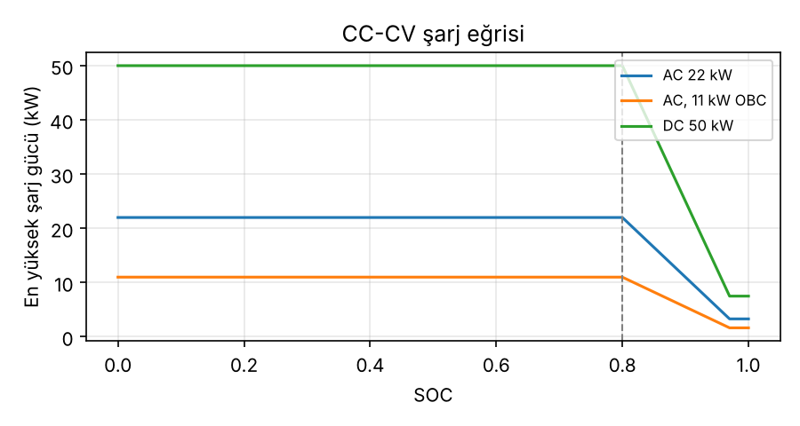
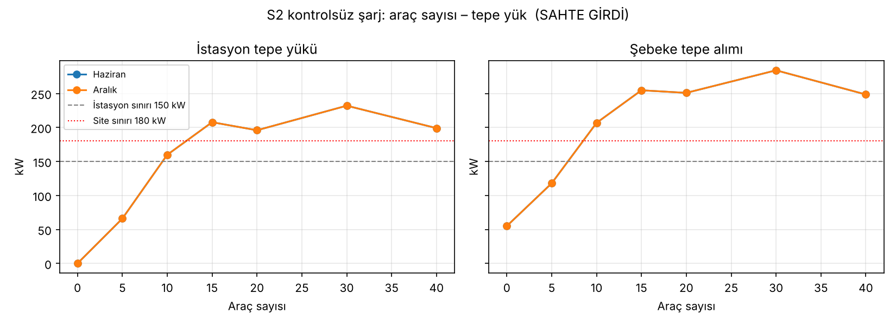
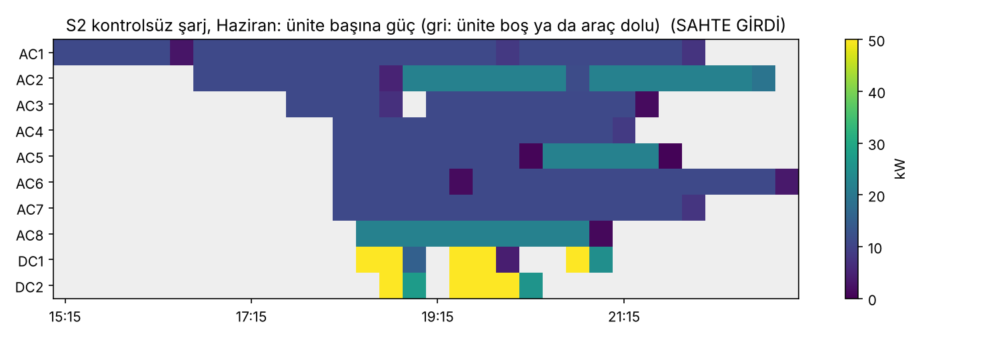

# Şarj istasyonu modeli (YM-2)

> Taslak (Hafta 9). Sayıların hepsi `scripts/ym2_hafta5_tepe_yuk.py` ve `scripts/ym2_rapor_grafikleri.py`
> çıktısıdır. **Şu anki sayılar sahte girdiyle (çan eğrisi PV, sentetik yük) üretildi.** Gerçek veriyle yeniden
> üretmek için: `python -m microgrid.data`, ardından iki betik. Rapora girmeden önce tablolar yenilenmeli.

## 1. İstasyonun tanımı

Site otoparkı (docs/kapsam.md): araçlar akşam eve dönüşte gelir, ertesi sabah ayrılır. Parametreler
`config/default.yaml` içindedir:

| Parametre | Değer | Kaynak |
| --- | --- | --- |
| Üniteler | 8 × AC 22 kW (Tip-2) + 2 × DC 50 kW (CCS2), kurulu 276 kW | EM-1, YM-2 |
| İstasyon güç sınırı | 150 kW | EM-1 |
| Site şebeke alım sınırı | 180 kW | EM-1 |
| Şarj verimi (şebeke → batarya) | 0,95 | YM-2 |
| CC-CV eşiği / taban | SOC 0,8 / anma gücünün %15'i | YM-2 |
| Araç sayısı | 20 | ekip kararı |
| V2G alt SOC | 0,3 | YM-2 |

## 2. Talep modeli

Her araç için (seed'li `numpy` üreteci, tekrar üretilebilir):

- Geliş saati ~ N(18,5; 1,5) sa, simülasyon başlangıcı (12:00) ile 12 saat sonrası arasına kırpılır.
- Ayrılış saati ertesi gün ~ N(7,5; 1,0) sa; en erken gelişten 1 saat sonra, en geç simülasyon sonunda.
- Geliş SOC ~ U(0,2; 0,6); hedef SOC 0,8.
- Araç modeli katalogdan payına göre seçilir:

| Model | Batarya (kWh) | AC/OBC (kW) | DC (kW) | V2G | Pay |
| --- | --- | --- | --- | --- | --- |
| Renault Zoe E-Tech | 52,0 | 22 | 50 | hayır | %25 |
| Tesla Model 3 SR+ | 60,0 | 11 | 170 | evet | %30 |
| Togg T10X Uzun Menzil | 88,5 | 22 | 150 | hayır | %25 |
| Hyundai Ioniq 5 | 77,4 | 11 | 220 | evet | %10 |
| Peugeot e-208 | 50,0 | 11 | 100 | hayır | %10 |

OBC (yerleşik şarj cihazı) sınırı önemlidir: filonun %50'si 22 kW AC ünitede yalnızca 11 kW çekebilir.

## 3. Ünite ataması, sıra ve nöbetleşe şarj

Her 15 dakikalık adımda istasyon sırasıyla: ayrılış saati gelen araçları üniteden çıkarır; yeni gelenleri FIFO
sıraya ekler; sırada bekleyen varsa hedef SOC'ye ulaşmış araçları üniteden alır (**nöbetleşe şarj**; araç
otoparkta kalır); sıranın başındakileri boş ünitelere bağlar (önce AC, AC kalmadıysa DC).

20 araç / 10 ünite olduğu için nöbetleşe şarj belirleyicidir. Kapalıyken araçların yarısı ünite bulmak için sabaha
kadar bekler (Tablo 2).

## 4. CC-CV şarj eğrisi



Ünitede çekilebilecek en yüksek güç önce donanımla sınırlanır: AC'de `min(OBC, ünite)`, DC'de `min(araç DC, ünite)`.
Sonra CC-CV uygulanır:

P(SOC) = P_anma, SOC < 0,8 iken; P(SOC) = P_anma · max(0,15; (1 − SOC) / 0,2), SOC ≥ 0,8 iken.

Hedef SOC 0,8 olduğu için varsayılan senaryolarda CV bölgesine girilmez. Hedef yükseltilirse (duyarlılık
analizi) gece sonu yükü uzar.

## 5. Döngüdeki yeri

```text
her adım:  vehicles = station.requests(ctx)          # bağlı araçlar ve sınırları (CC-CV, OBC, V2G)
           decision = ems.decide(...)                 # YM-3
           applied  = station.apply(ctx, decision.ev_kw)   # sınırlara kırp, SOC güncelle, uygulananı döndür
```

Güçler şebeke tarafıdır; bataryaya giren enerji güç × süre × 0,95. EMS 22 kW istese bile araç 2 kWh uzaktaysa
istasyon ancak o kadarını uygular; kayda giren her zaman uygulanan güçtür. Simülasyon sonunda araç başına oturum
tablosu (`SimResult.sessions`) çıkar: bekleme, alınan enerji, hedefe ulaştı mı.

## 6. V2G kuralı

V2G açıkken (`station.v2g_enabled`, Senaryo 6) V2G destekli araç her adımda şu sınırla deşarj edilebilir:

- SOC 0,3'ün altına inmez.
- Verilen enerji ayrılışa kadar geri doldurulabilmelidir. Bu adımdan sonra kalan süre t, tam şarj gücü p,
  verim η, batarya B için t · p · η ≥ (hedef − SOC) · B + E_çıkan olmalı, yani E_çıkan ≤ t · p · η − (hedef − SOC) · B.

Hedef CC-CV eşiğinin üstündeyse p olarak hedefteki (en düşük) CV gücü alınır; böylece yavaşlayan son kısım da
hesaba katılır. İstasyon bu iki koşulu uygular, yani deşarjdan sonra hedef her zaman *yetişilebilir* kalır; aracı
sonra tam güçle şarj etmek EMS'in işidir (deşarjdan sonra şarj etmeyen EMS'te araç hedefi kaçırır). İstasyon/site
güç sınırları bu hesapta yoktur. Test: 17–22 arası mümkün olan en fazla deşarjı, sonra tam şarjı isteyen bir EMS ile
20 araçta 58,8 kWh şebekeye verildi, bütün araçlar hedefe ulaştı; hedef 0,9–1,0 için de ayrı test var.

## 7. Sonuçlar (sahte girdi, Haziran)



**Tablo 1. Kontrolsüz şarjda araç sayısına göre tepe yük (S2).**

| Araç | İstasyon tepe (kW) | Saat | Şebeke tepe (kW) | 180 kW aşılan adım |
| --- | --- | --- | --- | --- |
| 5 | 66 | 19:15 | 118 | 0 |
| 10 | 160 | 19:30 | 207 | 2 |
| 15 | 210 | 19:30 | 257 | 6 |
| 20 | 210 | 19:45 | 261 | 6 |
| 30 | 232 | 20:15 | 287 | 13 |

10 araçtan itibaren istasyon 150 kW sınırını, site 180 kW sınırını aşıyor. 15 araçtan sonra tepe pek artmıyor
çünkü 10 ünitenin hepsi zaten dolu: tepeyi araç sayısı değil ünite sayısı belirliyor.



**Tablo 2. Kullanıcı memnuniyeti** (`ym2-memnuniyet.md`).

| | S2 kontrolsüz | S3 akıllı (geçici) | S2, nöbetleşe kapalı |
| --- | --- | --- | --- |
| Hedefe ulaşma oranı | 1,00 | 0,80 | 0,50 |
| Hizmet alamayan araç | 0 | 0 | 5 |
| Ortalama eksik enerji (kWh) | 0,0 | 5,2 | 10,5 |
| Ortalama bekleme (sa) | 0,2 | 4,7 | 5,7 |
| İstasyon tepe (kW) | 210 | 150 | 177 |

Kontrolsüz şarj şebekeye kötü (tepe 210 kW), kullanıcıya iyidir (herkes dolar). Şarjı bütün geceye yayan akıllı
şarj tepeyi 150 kW'a (istasyon sınırı) indiriyor ama üniteleri uzun süre tuttuğu için araçların %20'si hedefe yetişemiyor.
Ünite sayısı sınırlıyken iyi bir EMS hem tepeyi hem üniteyi yönetmeli. YM-3'ün EMS sonuçları gelince bu tablo
S3–S6 ile güncellenecek.

## 8. Sınırlamalar

- Talep modeli sentetik (normal/uniform dağılımlar); ACN-Data ile kalibre edilmedi.
- Optimizasyon için gün başında araçların geliş bilgisinin bilindiği varsayıldı (kusursuz bilgi).
- Planlama tüm araçların AC ünitede şarj olacağını varsayar; DC ünite yalnızca AC dolunca kullanılır.
- OBC çift yönlü kabul edildi (AC V2G'de deşarj sınırı OBC gücü).
- Tek temsili gün; araçlar her gün aynı dağılımdan gelir.
