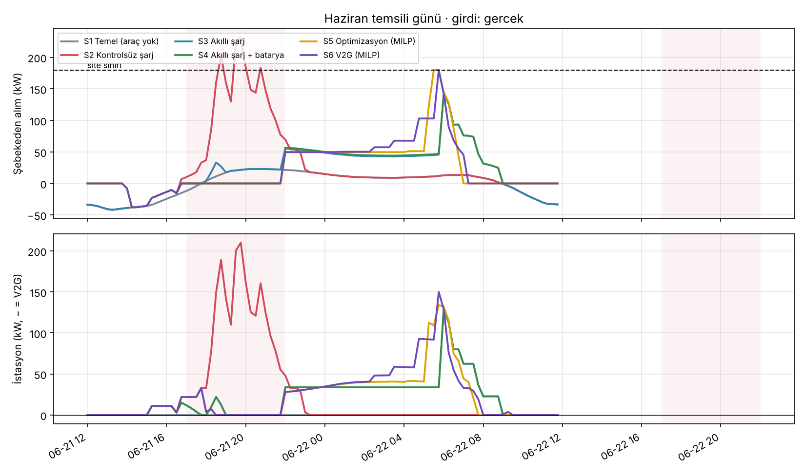
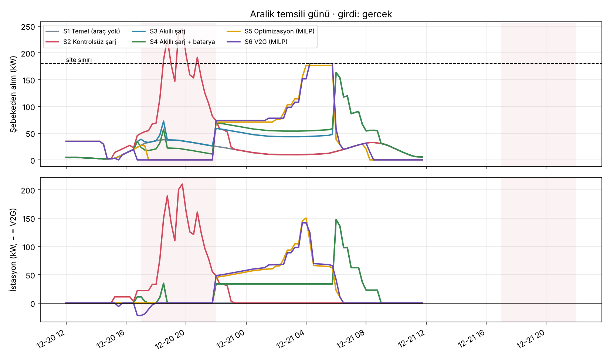

# Entegrasyon ve senaryo karşılaştırması (YM-4)

Bu bölüm modüllerin tek bir simülasyonda nasıl birleştiğini, sonuçların nasıl üretildiğini ve altı senaryonun
gerçek veriyle karşılaştırmasını anlatır. Veri (YM-1), istasyon (YM-2) ve EMS (YM-3) modellerinin ayrıntıları kendi
bölümlerindedir.

## 1. Mimari

Simülasyon 15 dakikalık adımlarla, öğlen 12:00'de başlayıp ertesi gün 12:00'de biten bir temsili gün boyunca
(96 adım) ilerler. Her adımda döngü modülleri sabit bir sırayla çağırır:

1. **İstasyon (YM-2)** ayrılan araçları çıkarır, gelenleri sıraya alır, boş ünitelere bağlar ve bağlı her aracın
   o adımdaki sınırlarını bildirir (`requests`: SOC, hedef, ayrılış saati, en yüksek şarj/deşarj gücü, CC-CV dahil).
2. **EMS (YM-3)** PV, sabit yük, tarife ve araç isteklerine bakıp araç başına güç ve batarya gücüne karar verir (`decide`).
3. İstasyon kararı ünite ve araç sınırlarına göre uygular, SOC'leri günceller (`apply`); batarya da kendi sınırlarını uygular.
4. **Güç dengesi:** `şebeke = sabit yük + istasyon + batarya − PV`.
5. **Şebeke (pandapower)** yük akışını çözer: bara gerilimleri, kablo ve trafo yüklenmesi.

Modüller birbirini doğrudan çağırmaz; yalnızca `src/microgrid/interfaces.py`'deki veri tiplerini (`VehicleRequest`,
`EmsInputs`, `Decision`) kullanır. Bu sözleşme 2. haftada yazıldı. Böylece her modül ötekiler hazır olmadan sahte
(mock) karşılıklarıyla geliştirilip test edilebildi; gerçek modüller geldikçe senaryo tanımında tek satır değişti
(`src/microgrid/sim/scenarios.py`).

## 2. Senaryolar

Altı senaryonun hepsinde istasyon aynıdır: site otoparkı, 20 araç, 8 × AC 22 kW + 2 × DC 50 kW ünite, istasyon
sınırı 150 kW, sitenin şebekeden çekebileceği en yüksek güç 180 kW.

| | Senaryo | Yönetim |
| --- | --- | --- |
| S1 | Temel | Araç yok (karşılaştırma tabanı) |
| S2 | Kontrolsüz şarj | Araç geldiği an tam güçle şarj olur |
| S3 | Akıllı şarj | Kural tabanlı: şarj ayrılışa kadarki en ucuz tarife adımlarına yayılır |
| S4 | Akıllı şarj + batarya | S3 + 200 kWh / 100 kW batarya |
| S5 | Optimizasyon | Kayan ufuklu MILP: en düşük maliyet |
| S6 | V2G | S5 + araçtan şebekeye deşarj |

## 3. Sonuçların üretimi ve doğrulama

- **Tek kaynak.** Bütün tablolar `python -m microgrid.sim.sonuclar` ile üretilir. Komut altı senaryoyu iki temsili
  günde, aynı girdilerle ve yük akışıyla çalıştırır. Dashboard aynı fonksiyonları kullandığı için ekranda görünen
  sayılarla rapordaki sayılar aynıdır.
- **Tekrarlanabilirlik.** Rapordaki sayılar GitHub Actions'ta (`sonuclar` iş akışı) temiz bir ortamda, PVGIS
  verisi indirilerek üretildi. Herkes aynı sürümlerle aynı sonucu alır. Araç gelişleri sabit tohumla üretildiği için
  aynı gün her çalıştırmada aynıdır.
- **Testler.** Her PR'da 240'ı aşkın birim testi çalışır; bunlar her adımda güç dengesini, batarya ve araç SOC
  sınırlarını, istasyon ve site sınırlarını ve dashboard'un her senaryoda hatasız açıldığını kontrol eder.

## 4. Sonuçlar

Girdi: Bandırma PVGIS (2023), BDEW yük profilleri, EPDK üç zamanlı tarife (Veri ve Yöntem bölümü). Kaynak:
`sonuclar` iş akışı, 26.11.2026.

**Tablo 4.1. Haziran temsili günü (gerçek veri).**

| Gösterge | S1 | S2 | S3 | S4 | S5 | S6 |
| :-------------------------------- | -----: | -----: | -----: | -----: | -----: | -----: |
| Şebeke tepe alımı (kW) | 23 | 232 | 141 | 141 | 180 | 180 |
| Tepe saati | 20:30 | 19:45 | 06:00 | 06:00 | 05:45 | 05:45 |
| Puant (17–22) tepe alımı (kW) | 23 | 232 | 33 | 0 | 0 | 0 |
| Günlük maliyet (TL) | 892 | 4.262 | 2.541 | 2.044 | 1.861 | 1.951 |
| Araçlara verilen enerji (kWh) | 0 | 590 | 486 | 486 | 529 | 562 |
| Hedef SOC'ye ulaşan araç | — | %100 | %80 | %80 | %90 | %95 |
| Ortalama ünite beklemesi (sa) | — | 0,2 | 4,7 | 4,7 | 4,4 | 4,0 |
| V2G ile şebekeye (kWh) | 0 | 0 | 0 | 0 | 0 | 0 |
| Site sınırı aşılan adım | 0 | 5 | 0 | 0 | 0 | 0 |
| En düşük gerilim (p.u.) | 0,993 | 0,961 | 0,977 | 0,977 | 0,970 | 0,970 |
| Trafo en yüksek yüklenme (%) | 11 | 60 | 36 | 36 | 47 | 47 |

**Tablo 4.2. Aralık temsili günü (gerçek veri).**

| Gösterge | S1 | S2 | S3 | S4 | S5 | S6 |
| :-------------------------------- | -----: | -----: | -----: | -----: | -----: | -----: |
| Şebeke tepe alımı (kW) | 38 | 246 | 163 | 163 | 177 | 180 |
| Tepe saati | 18:30 | 19:45 | 06:00 | 06:00 | 05:30 | 05:00 |
| Puant (17–22) tepe alımı (kW) | 38 | 246 | 72 | 57 | 28 | 0 |
| Günlük maliyet (TL) | 2.045 | 5.532 | 3.808 | 3.586 | 3.332 | 3.283 |
| Araçlara verilen enerji (kWh) | 0 | 590 | 486 | 486 | 573 | 590 |
| Hedef SOC'ye ulaşan araç | — | %100 | %80 | %80 | %90 | %90 |
| Ortalama ünite beklemesi (sa) | — | 0,2 | 5,2 | 5,2 | 3,9 | 3,9 |
| V2G ile şebekeye (kWh) | 0 | 0 | 0 | 0 | 0 | 21 |
| Site sınırı aşılan adım | 0 | 6 | 0 | 0 | 0 | 0 |
| En düşük gerilim (p.u.) | 0,988 | 0,960 | 0,973 | 0,973 | 0,970 | 0,969 |
| Trafo en yüksek yüklenme (%) | 10 | 64 | 42 | 42 | 46 | 47 |

## 5. Bulgular

**5.1 Kontrolsüz şarj şebekeyi sınırın ötesine taşıyor.** Araçlar eve dönüş saatinde geldiği için istasyon yükü
puant tarifesine (17–22) ve sitenin akşam tüketimine denk geliyor. Şebeke alımı araçsız güne göre 10 kat artıyor
(Haziran 23 → 232 kW), site sınırı (180 kW) Haziran'da 5, Aralık'ta 6 adım (1,25–1,5 saat) aşılıyor. Araç şarjının
%90'ı en pahalı tarife diliminde. En düşük gerilim 0,96 p.u.'ya, trafo yüklenmesi %60–64'e çıkıyor. Gerilim sınırın
(0,95) içinde kalıyor, ama asıl kısıt güç sınırı.

**5.2 Akıllı şarj akşam tepesini ortadan kaldırıyor.** Puant tepe alımı S3'te 232'den 33 kW'a (Haziran, −%86),
246'dan 72 kW'a (Aralık, −%71) iniyor; S4–S6'da puantta araç şarjı neredeyse hiç kalmıyor. Site sınırı hiçbir akıllı
senaryoda aşılmıyor.

**5.3 Maliyetler aynı enerji üzerinden karşılaştırılmalı.** S3 ve S4 araçlara 590 yerine 486 kWh veriyor (araçların
%20'si hedefe ulaşamıyor); S5 ve S6 da hedefi %90–95 karşılıyor. Ham günlük maliyet bu yüzden akıllı şarjı
olduğundan daha iyi gösterir. Adil karşılaştırma için araçların siteye getirdiği ek maliyeti (S1'e göre) verilen
enerjiye böldük:

| | S2 | S3 | S4 | S5 | S6 |
| --- | ---: | ---: | ---: | ---: | ---: |
| Haziran, TL/kWh | 5,71 | 3,39 | 2,37 | 1,83 | 1,88 |
| Aralık, TL/kWh | 5,91 | 3,63 | 3,17 | 2,25 | 2,10 |

Bu ölçüte göre de kWh başına maliyet kontrolsüz şarja göre yarıdan fazla düşüyor. Ama düşüşün bir kısmı daha az
enerji verilmesinden geliyor; bunu "kullanıcıya hizmet" ölçütleriyle birlikte okumak gerekir. S4–S6'da bataryanın sabit
yük maliyetine etkisi de bu sayının içinde.

**5.4 Tepe yok olmuyor, gece tarifesinin bitişine kayıyor.** Akıllı senaryoların en yüksek alımı akşam değil
sabah: S3/S4'te 06:00'da (141–163 kW), S5/S6'da 05:00–05:45'te ve site sınırına dayanarak (177–180 kW). Gece tarifesi
06:00'da bittiği için maliyeti en aza indiren kural ya da optimizasyon kalan şarjı bu saatten hemen önceye topluyor.
Aynı etkiyi 6. haftada basit bir zaman kaydırma kuralında da gördük: herkes 22:00'de şarja başlayınca 180 kW'lık yeni
bir tepe oluşmuştu. **Sonuç: maliyeti en aza indirmek ile tepeyi en aza indirmek aynı hedef değil.** MILP tepeyi
düşürsün diye amaç fonksiyonundaki tepe ağırlığı artırılabilir, ya da sabah için ayrı bir güç sınırı konabilir.

**5.5 Batarya yazın değerli.** S4'te batarya Haziran'da puant alımını sıfırlıyor ve maliyeti S3'e göre %20
düşürüyor; Aralık'ta düşüş %6. Yazın gündüz PV fazlası bataryayı dolduruyor, kışın bu fazla yok (Aralık'ta PV'nin
tamamı sitede tüketiliyor).

**5.6 V2G bu sitede küçük.** Araçlar akşam düşük SOC'yle gelip sabah dolu ayrılmak zorunda olduğu için şebekeye
verebilecekleri enerji az: Haziran'da hiç, Aralık'ta 21 kWh. Bu, YM-3'ün sahte istasyonla bulduğu sonuçla uyumlu.

**5.7 Kullanıcı tarafında bedel: ünite beklemesi.** 20 araca 10 ünite var. Kontrolsüz şarjda araçlar çabuk dolup
üniteyi bıraktığı için ortalama bekleme 0,2 saat. Akıllı senaryolarda şarj geceye yayıldığından üniteler sabaha kadar
dolu kalıyor; bekleme 4–5 saate çıkıyor ve bazı araçlar hedefe yetişemiyor. İyi bir EMS yalnızca gücü değil ünite
sırasını da yönetmeli.

## 6. Entegrasyonda bulunan hatalar

Modüller ayrı ayrı testlerden geçiyordu; aşağıdaki hatalar ancak birlikte çalıştırılınca görüldü:

| Hata | Etkisi | Çözüm |
| --- | --- | --- |
| Kural tabanlı EMS istasyonun %95 şarj verimini hesaba katmıyordu (sahte istasyon kayıpsızdı) | S3'te araçların yalnızca %55'i hedefe ulaşıyordu; maliyet yanıltıcı biçimde düşük görünüyordu | İhtiyaç şebeke tarafında, verime bölünerek planlandı (MILP'deki gibi). Hedefe ulaşma %80'e çıktı |
| KPI modülü MILP'in çözücü toleransını (~0,0000005 kW) sınır aşımı sayıyordu | S5'te 3 adım hayalî "site sınırı aşımı" | Aşım eşiği 1 W yapıldı |
| YM-3'ün sonuçları sahte istasyonla üretilmişti | S5 tepe alımı 67 kW görünüyordu; gerçek istasyonla 177–180 kW | Bütün sonuçlar gerçek istasyonla yeniden üretildi (bu bölümdeki tablolar) |

## 7. Sınırlamalar

- Her mevsim için tek bir temsili gün ve tek bir araç gelişi örneği kullanıldı; günden güne değişkenlik yok.
- MILP gün başında araçların ne zaman geleceğini bilmiyor (kayan ufuk), ama bağlı araçların ayrılış saatini biliyor.
- Hedef SOC MILP'te kesin değil, cezalı bir kısıt: optimizasyon bazı araçları hedefin biraz altında bırakabiliyor
  (S5'te %90).
- Kontrolsüz şarjda istasyonun 150 kW sınırı uygulanmıyor (sınırı uygulayacak bir yönetim yok); S2'deki aşım bu
  varsayımın sonucu.
- Simulink dinamik sonuçları (D1–D4) bu bölümde yok.
