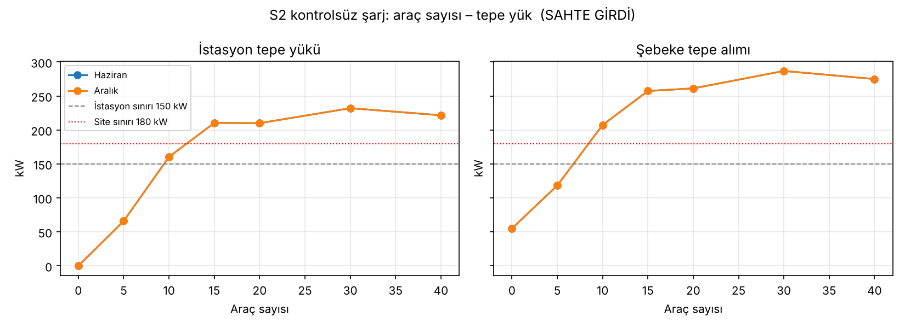

# Hafta 3–7 · YM-2 (Şarj istasyonu) · Gerçek istasyon döngüde

Rapor: 26 Kasım 2026. Hafta 3–7 görevleri bu hafta topluca tamamlandı ve tek PR'da birleşiyor.

## Bu hafta yapılanlar

- **H3: ChargingStation v1, sözleşmedeki `requests/apply` arayüzüyle.** Hafta 2 sınıfları (`ElectricVehicle`,
  `ChargingUnit`, `ChargingStation`, `DemandModel`) adlarıyla korundu, içleri sözleşmeye göre yeniden yazıldı:
  `pd.Timestamp` zamanlar, `AC1…DC2` kimlikleri, bütün parametreler `config/default.yaml`'dan.
  - Talep modeli: geliş N(18,5; 1,5) sa, ayrılış ertesi sabah N(7,5; 1,0) sa, geliş SOC U(0,2; 0,6), hedef 0,8
    (ekip kararı). Hafta 2 araç kataloğu config'e eklendi: Zoe, Tesla Model 3, Togg T10X, Ioniq 5, e-208
    (batarya 50–88,5 kWh, OBC 11/22 kW, V2G desteği).
  - CC-CV: SOC %80'e kadar anma gücü, sonra doğrusal azalma, taban %15. 11 kW OBC'li araç 22 kW ünitede 11 kW çeker.
  - Atama: araç FIFO sıraya girer, önce AC, AC kalmadıysa DC üniteye bağlanır.
  - **Nöbetleşe şarj:** 20 araç / 10 ünite var. Sırada bekleyen varsa hedefe ulaşan araç üniteyi bırakır
    (`station.rotate_when_full`). Kapalıyken araçların yarısı sabaha kadar bekliyor (aşağıdaki tablo).
  - Birim testleri: 40+ test (CC-CV, OBC, sıra, rotasyon, enerji korunumu, oturum tablosu).
- **H4: İstasyon döngüde.** Senaryoların ve `python -m microgrid.sim`'in varsayılan istasyonu artık gerçek istasyon;
  dashboard S1/S2'yi bununla çiziyor (S2 artık "geçici" değil). `SimResult.sessions`: araç başına oturum tablosu.
- **H5: Araç sayısına göre tepe yük ve kritik an** (`station/analysis.py`, `scripts/ym2_hafta5_tepe_yuk.py`).
- **H6: Akıllı şarj desteği:** `by_departure` (güç bütçesini ayrılışı en yakın araçtan başlayarak dağıtır) ve
  kullanıcı memnuniyeti KPI'ı `satisfaction` (hedefe ulaşma oranı, hizmet alamayan, eksik enerji, bekleme).
- **H7: Optimizasyona istasyon kısıtları:** `planned_sessions()` ve `n_chargers`; tablo ve MILP karşılıkları
  `docs/arayuz-sozlesmesi.md`'de.

## Kanıt

**Uyarı:** grafik ve aşağıdaki tablo **sahte girdiyle** (çan eğrisi PV, sentetik yük) üretildi; PVGIS'e bu ortamdan
erişilemedi. Gerçek veriyle: `python -m microgrid.data` ardından `python scripts/ym2_hafta5_tepe_yuk.py`.

Kontrolsüz şarjda (S2, 20 araç) istasyon tepe yükü ~210 kW (19:45): 150 kW istasyon sınırını aşıyor; o anda
8 AC + 2 DC ünitenin hepsi şarj ediyor, bağlı araçların ortalama SOC'si 0,53. EM ekibi D2'yi bu değerlerle kurabilir.

Kullanıcı memnuniyeti (sahte girdi, Haziran):

| | S2 kontrolsüz | S3 akıllı (geçici, YM-4) | S2, nöbetleşe kapalı |
| --- | --- | --- | --- |
| Hedefe ulaşma oranı | 1,00 | 0,55 | 0,50 |
| Hizmet alamayan araç | 0 | 3 | 5 |
| Ortalama bekleme (sa) | 0,2 | 5,2 | 5,7 |
| Araç şarjı (kWh) | 590 | 453 | 369 |
| İstasyon tepe (kW) | 210 | 110 | 177 |

## Karşılaşılan sorunlar

- **Geç birleşme:** Hafta 2 kodu sözleşmedeki arayüzden önce yazılmıştı ve main'e hiç girmedi; döngü bu yüzden
  Hafta 4–7 boyunca sahte istasyonla çalıştı. Bu PR'la kapanıyor.
- **S3 ünite paylaşımıyla çakışıyor:** Geçici akıllı şarj (CheapHoursEMS) her aracın şarjını bütün geceye yaydığı
  için hiçbir araç sabaha kadar dolmuyor, ünite boşalmıyor, sıradakiler hedefe yetişemiyor (tablo, orta sütun).
  İstasyon doğru davranıyor; EMS sırayı hesaba katmalı. İlgili test (`test_s3_…`) bu yüzden gerekçesiyle
  `xfail` işaretlendi; YM-3/YM-4 kararı bekleniyor.

- **Kontrolsüz EMS'te verim hatası (düzeltildi):** `UncontrolledEMS` aracın batarya tarafı ihtiyacını (`need/dt`)
  istiyordu; istasyon %5 verim kaybını düşünce her adım ihtiyacın %5'i kalıyor, araç hedefe asimptotik yaklaşıp
  üniteyi ~1 saat fazladan tutuyordu. Artık tam güç isteniyor, istasyon hedefe kalan payla kırpıyor (YM-4'ün
  dosyasında tek satır; sahte istasyonla sonuç değişmiyor).

## Gelecek hafta (Hafta 8)

- V2G: araç deşarj kuralı, minimum SOC (0,3) garantisi, ayrılışta hedef SOC garantisi.
