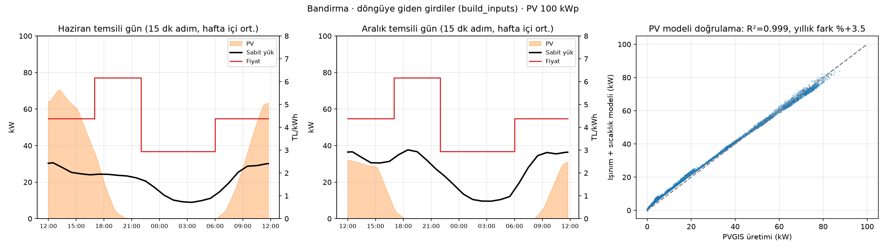

# Hafta 3 · YM-1 (Veri katmanı) · 22–28 Ekim 2026

Rapor: 29 Ekim tatil → gruba yazılır, 5 Kasım'da 2 haftalık birlikte sunulur.

## Bu hafta yapılanlar

- **Döngüye giden girdi tablosu: `build_inputs(cfg, index)`** (`src/microgrid/data/inputs.py`).
  Arayüz sözleşmesindeki YM-1 sınırı: her 15 dakikalık adım için `pv_kw`, `base_load_kw`, `price_tl_per_kwh`.
  YM-4 döngüde `mock_inputs` yerine bunu çağırınca gerçek veriyle çalışır.
  - Saatlik veriden 15 dakikaya **doğrusal** ara değerleme. Güç 4'e bölünmez, enerji korunur (testli, fark < %2).
  - Her saatlik değer temsil ettiği ana yerleştiriliyor: PV saatin 10. dakikasına (PVGIS'in hesap anı),
    yük saatin ortasına (saatlik ortalama). Böylece PV eğrisi kaymıyor.
  - **Temsili gün (ekip kararı):** `inputs.mode: average_day`, simülasyon tarihinin ayına ait hafta içi ortalama gün.
    Haziran yerine Aralık için yalnızca `simulation.start` tarihini değiştirmek yeterli.
    İstenirse `mode: actual` ile verideki gerçek bir gün (ör. bulutlu gün) kullanılabiliyor.
- **PV modeli** (`src/microgrid/data/pv.py`): Kurulu güce ölçekleme (`pv_kw = 100 kWp × kW/kWp`) ve
  ışınım + sıcaklıktan üretimi hesaplayan fiziksel model (`pv_from_irradiance`). Fiziksel model PVGIS sonucunu
  bağımsız olarak doğruluyor; ayrıca D3 (bulut geçişi) ve Hafta 7 (ertesi gün tahmini) için ışınımdan üretim hesaplayabiliyor.
- **Tarife modülü** (`src/microgrid/data/tariff.py`): Her adımın üç zamanlı fiyatı. Fiyatlar EPDK 4 Nisan 2026
  resmî tablosundan doğrulandı (AG mesken, enerji + dağıtım bedeli): gündüz 4,3755 / puant 6,1725 / gece 2,9386 TL/kWh.
- **Testler:** 8 yeni test (dilim sınırları, adım sayıları, PV modeli, sözleşme sütunları, enerji korunumu,
  ay seçimi, gerçek gün modu, doğrusal ara değerleme). Toplam 21 test geçiyor.

## Kanıt

| Temsili gün (hafta içi ort.) | Haziran | Aralık |
| --- | --- | --- |
| PV üretimi | 523 kWh | 193 kWh |
| Sabit yük | 498 kWh | 628 kWh |
| Puantta (17–22) ortalama sabit yük | 24 kW | 34 kW |
| Puantta PV üretimi | 50 kWh | 3 kWh |
| Sabit yükün PV'den sonra kalan maliyeti (EV yok, Senaryo 1'e yakın) | 892 TL/gün | 2045 TL/gün |

**PV modeli doğrulaması:** Işınım ve sıcaklıktan hesaplanan üretim, PVGIS'in kendi hesabıyla saat saat örtüşüyor
(R² = 0,999). Yıllık fark %3,5 (model biraz fazla tahmin ediyor; PVGIS açı ve spektrum kayıplarını da hesaba katıyor).
Döngüde PVGIS değeri kullanılıyor, model doğrulama ve ışınım senaryoları için.

**Yorum:** Haziranda PV gün içinde sabit yükün iki katına çıkıyor ama puantta neredeyse bitiyor; Aralıkta puantta hiç yok.
Akşam gelen araçların kontrolsüz şarjı, fiyatın en yüksek (6,17 TL/kWh) ve PV'nin olmadığı saate düşecek.
Gece fiyatı (2,94) puantın yarısından az; akıllı şarjın yükü geceye kaydırmasının tasarrufu buradan gelecek.

## Entegrasyon notu (YM-4)

- `from microgrid.data.inputs import build_inputs` → `run(cfg, build_inputs(cfg, time_index(cfg)), ...)`.
- Önce veri dosyaları üretilmeli (repoya girmez): `python -m microgrid.data.pvgis` ve `python -m microgrid.data.loads`.
  Dosya yoksa `build_inputs` ne çalıştırılacağını söyleyen bir hata veriyor.
- Config'e `inputs` bölümü eklendi (`mode`, `weekdays_only`). `simulation.start` ve `timezone` YM-4'ün branch'inden gelecek.

## Sorunlar / sorular

- PV fazlasının şebekeye satışı sonraki aşamaya bırakıldı; Haziranda gündüz önemli fazla var (BESS için fırsat).
- BDEW yük profillerinin Türkiye'ye uygunluğu hâlâ hocaya sorulacak (yaz klima yükü yok).

## Gelecek hafta (Hafta 4, v0)

- Gerçek verileri 24 saatlik döngüye bağlamak: YM-4 ile `build_inputs`'u döngüye takıp v0'ı uçtan uca çalıştırmak.
