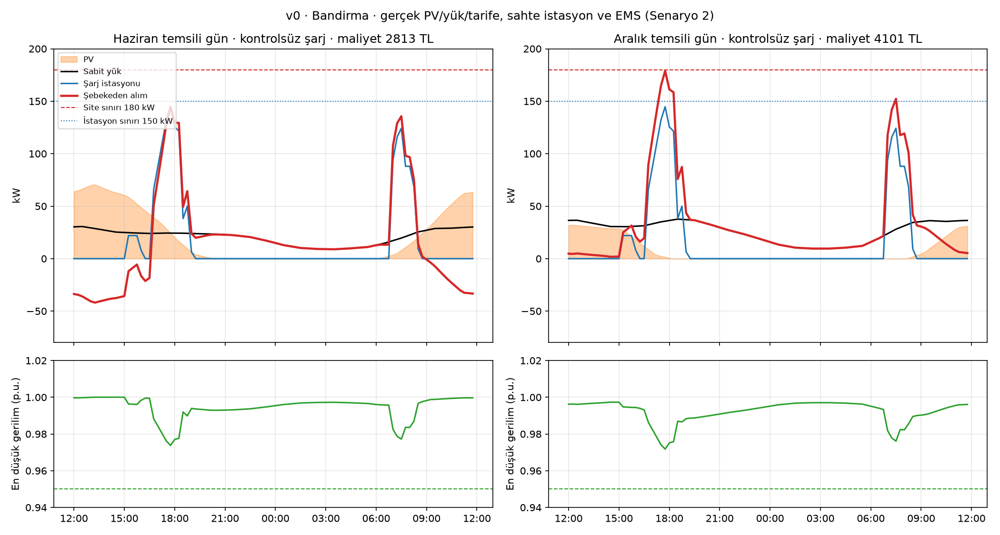

# Hafta 4 · YM-1 (Veri katmanı) · v0

## Bu hafta yapılanlar

- **Gerçek veriler döngüye bağlandı (v0).** `python -m microgrid.sim` artık sahte girdiler yerine YM-1'in
  `build_inputs` tablosunu kullanıyor: Bandırma PVGIS üretimi, BDEW sabit yük profilleri (50 daire + ortak alan/dükkânlar)
  ve EPDK üç zamanlı tarife. Döngü pandapower yük akışıyla birlikte 24 saat (96 adım × 15 dk) uçtan uca çalışıyor.
  - `--gun haziran | aralik | ikisi`: ekip kararındaki temsili günler (hafta içi ortalama, öğlen → öğlen).
  - `--mock`: veri dosyaları yoksa eski sahte girdilerle çalışır.
  - İstasyon ve EMS hâlâ sahte (kontrolsüz şarj, Senaryo 2); YM-2 ve YM-3 modülleri gelince takılacak.
- **Veri hazırlama tek komut:** `python -m microgrid.data` PVGIS verisini indirip temizler ve yük profillerini üretir.
  Repoyu yeni klonlayan herkes bir kez çalıştırır.
- **Testler:** v0'ın iki temsili günde gerçek veriyle çalıştığını kontrol eden testler (yük akışı yakınsıyor,
  güç dengesi her adımda tutuyor). Toplam 42 test geçiyor.

## Kanıt

| v0, kontrolsüz şarj | Haziran | Aralık |
| --- | --- | --- |
| PV üretimi | 523 kWh | 193 kWh |
| Sabit yük | 498 kWh | 628 kWh |
| Araç şarjı | 386 kWh | 386 kWh |
| Şebeke tepe yükü | 145 kW (17:45) | 179 kW (17:45) |
| Günlük maliyet | 2813 TL | 4101 TL |
| En düşük gerilim | 0,974 p.u. | 0,972 p.u. |
| En yüksek kablo / trafo yüklenmesi | %79 / %38 | %80 / %46 |

**Yorum:** Aralıkta kontrolsüz şarjla şebeke tepesi 179 kW'a çıkıyor; 180 kW site sınırının hemen altında.
Tepe, puant tarifesinin (17–22) içinde ve PV'nin bittiği saatte. Haziranda gündüz PV fazlası şebekeye veriliyor
(negatif alım), ama akşam tepesi yine PV'siz. Gerilim 0,95 sınırının üstünde kalıyor; asıl sorun gerilim değil,
tepe yük ve maliyet. Akıllı şarj (Senaryo 3) bu tepeyi geceye kaydırmalı.

## Sınırlamalar (sahte istasyon kaynaklı)

- Sabah 07:00 civarındaki ikinci şarj tepesi gerçek değil: 20 araca 10 ünite olduğu için akşam yer bulamayan araçlar
  sabah üniteler boşalınca bağlanıyor. YM-2'nin istasyon modeli gelince düzelecek.
- Bataryayı sahte EMS kullanmıyor; BESS etkisi Senaryo 4'te görülecek.

## Gelecek hafta

- KPI modülü: tepe yük, maliyet, yenilenebilir payı, öz tüketim (YM-1, Hafta 5).
