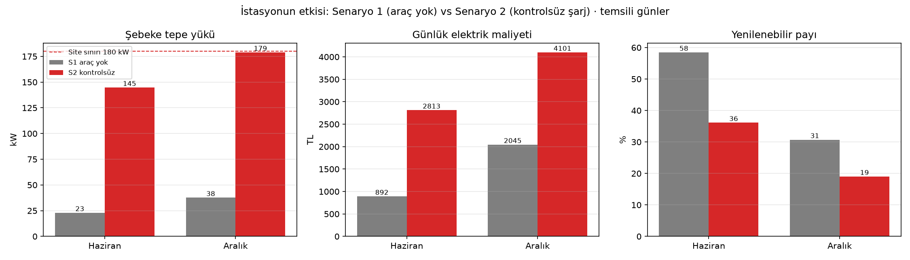

# Hafta 5 · YM-1 (Veri katmanı) · KPI modülü

## Bu hafta yapılanlar

- **KPI modülü** (`src/microgrid/kpi.py`). Döngünün adım tablosundan bütün senaryolar için aynı tanımlarla hesaplanıyor:
  - **Tepe yük:** şebekeden en yüksek alım (kW) ve saati, puant saatindeki tepe.
  - **Maliyet:** toplam TL, ortalama ödenen fiyat, alımın tarife dilimlerine (gündüz/puant/gece) dağılımı.
  - **Yenilenebilir payı:** tüketimin PV'den karşılanan kısmı. **Öz tüketim:** PV'nin sitede kullanılan kısmı.
  - Ek olarak: araç şarjının puanttaki payı (akıllı şarjın etkisini gösterecek), yük faktörü, site (180 kW) ve istasyon
    (150 kW) sınırı aşımları, en düşük gerilim, kablo/trafo yüklenmesi.
  - `compute(steps)` tek senaryo, `compare({...})` senaryo tablosu. Komut satırı: `python -m microgrid.kpi`
    → `results/` altındaki bütün sonuçların tablosu (`results/kpi.csv`). Dashboard KPI kartları bu adları kullanabilir.
- **Senaryo 1 vs Senaryo 2 karşılaştırması** (`scripts/ym1_hafta5_kpi.py`): gerçek veri, pandapower, iki temsili gün.
- **Testler:** elle hesaplanabilen 4 adımlık tabloyla tanımların doğruluğu, sahte döngüyle uçtan uca. 4 yeni test.

## Kanıt

| | Haziran S1 | Haziran S2 | Aralık S1 | Aralık S2 |
| --- | --- | --- | --- | --- |
| Şebeke tepe yükü | 23 kW | 145 kW | 38 kW | 179 kW |
| Günlük maliyet | 892 TL | 2813 TL | 2045 TL | 4101 TL |
| Puantta alınan enerji | 74 kWh | 272 kWh | 165 kWh | 370 kWh |
| Yenilenebilir payı | %58 | %36 | %31 | %19 |
| En düşük gerilim | 0,99 p.u. | 0,97 p.u. | 0,99 p.u. | 0,97 p.u. |
| En yüksek kablo yüklenmesi | %23 | %79 | %21 | %80 |

S1: araç yok. S2: kontrolsüz şarj (20 araç, sahte istasyon).

**Yorum:** Kontrolsüz şarj tepe yükü Haziranda 6, Aralıkta 5 katına çıkarıyor; Aralıkta 180 kW site sınırına 1 kW kalıyor.
Araçların 386 kWh'lik şarjı günlük maliyeti 1900–2050 TL artırıyor. Bunun sebebi enerjinin yarısının (%53) en pahalı
puant diliminde (6,17 TL/kWh) çekilmesi. Aynı enerji gece diliminde (2,94 TL/kWh) çekilseydi bu ek maliyetin yarısından
fazlası ortadan kalkardı; Senaryo 3'ün (akıllı şarj) hedefi bu. Gerilim 0,95 sınırının rahatça üstünde, kablo yüklenmesi
%80'e çıkıyor: sorun gerilimden çok tepe yük ve maliyet.

## Tanımlar

- alım = Σ max(şebeke, 0) · dt; veriş = Σ max(−şebeke, 0) · dt (PV fazlası; satış şimdilik ücretsiz)
- tüketim = Σ (sabit yük + araç şarjı) · dt; batarya depo sayılır
- öz tüketim = (PV − veriş) / PV; yenilenebilir payı = (PV − veriş) / tüketim

## Gelecek hafta

- Temsili gün → hafta/yıl genişletmesi ve mevsim profilleri (Hafta 6).
- Kullanıcı memnuniyeti KPI'ı (hedef SOC'ye ulaşma) YM-2'de; istasyon modeli gelince bu tabloya eklenecek.
