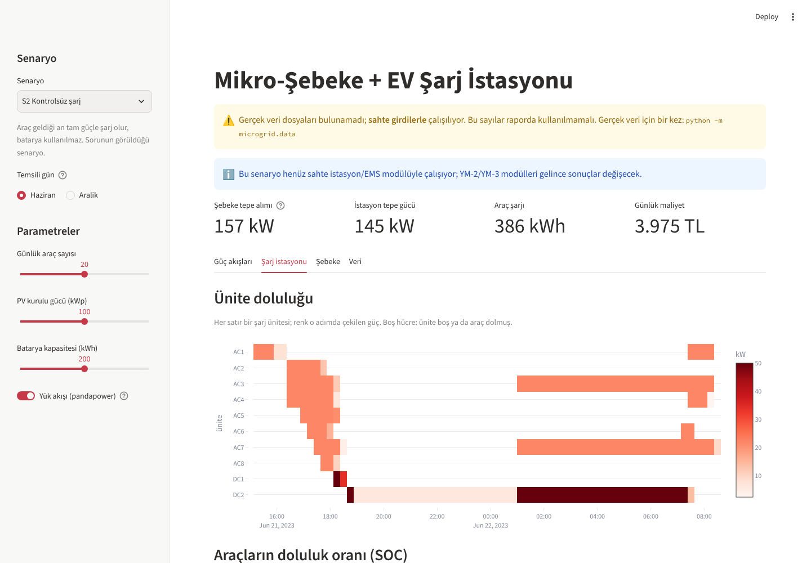

# Hafta 5 · YM-4 (Entegrasyon) · Dashboard iskeleti

## Bu hafta yapılanlar

- **Senaryo altyapısı (`sim/scenarios.py`).** Bir senaryo; istasyon, EMS ve batarya modüllerini ve config
  değişikliklerini tek yerde tanımlıyor. Şimdilik S1 (araç yok, karşılaştırma tabanı) ve S2 (kontrolsüz şarj) var.
  YM-2/YM-3 modülleri gelince Senaryo 3–6 listeye tek satırla eklenecek; dashboard onları kendiliğinden gösterecek.
  Config yolları yanlış yazılırsa (`vehicle.count` gibi) sessizce yeni anahtar eklenmiyor, hata veriyor.
- **Dashboard (`dashboard/app.py`, `dashboard/charts.py`).**
  - Kenar çubuğu: senaryo, temsili gün (Haziran / Aralık), araç sayısı, PV gücü, batarya kapasitesi, yük akışı aç/kapa.
    Senaryonun sabitlediği parametre (S1'de araç sayısı) kaydırıcıda kilitli görünüyor.
  - **Güç akışları:** PV, sabit yük, istasyon, batarya ve şebeke; site (180 kW) ve istasyon (150 kW) sınırları,
    puant saatleri (17–22) gölgeli.
  - **Şarj istasyonu görünümü:** ünite × zaman ısı haritası (hangi ünite ne zaman dolu, kaç kW çekiyor) ve
    araç başına SOC eğrileri.
  - **Şebeke:** pandapower sonuçları: en düşük gerilim (0,95 p.u. sınırıyla), kablo ve trafo yüklenmesi.
  - Veri yoksa sahte girdiyle çalıştığını, senaryo sahte modül kullanıyorsa bunu üstte açıkça yazıyor.
- **Testler:** her senaryo çalışıyor ve güç dengesi tutuyor; dashboard Streamlit test aracıyla tarayıcısız açılıyor
  ve her senaryoda hatasız çiziliyor. Dashboard'u kıran bir değişiklik CI'da yakalanır.

## Kanıt



*(Sahte girdiler ve sahte istasyonla; sayılar rapor için değil, görünümü göstermek için.)*

## Gözlem: sahte istasyonun sınırı ısı haritasında görünüyor

DC2 ünitesi 19:00–01:00 arasında çok düşük güçle şarj ediyor, gece 01:00'den sonra da 3 ünite yeniden doluyor.
Bunun sebebi `MockStation`: 20 araca 10 ünite var; akşam yer bulamayan araçlar ünite boşalınca bağlanıyor ve CC-CV
eğrisi yok. Gerçek istasyon modeli (YM-2) gelmeden Senaryo 2'nin sayıları kesin değil.

## Nasıl çalıştırılır

```bash
streamlit run dashboard/app.py
```

## Gelecek hafta

- KPI kartları (YM-1'in KPI modülüyle) ve kontrolsüz vs. akıllı şarj karşılaştırma grafiği.
