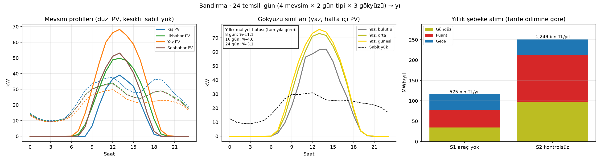

# Hafta 6 · YM-1 (Veri katmanı) · Mevsim profilleri ve yıla genişletme

## Bu hafta yapılanlar

- **Mevsim profilleri ve temsili günler** (`src/microgrid/data/seasons.py`). Yıl 24 temsili günle özetleniyor:
  4 mevsim × 2 gün tipi (hafta içi; hafta sonu + resmî tatil) × 3 gökyüzü sınıfı (bulutlu / orta / güneşli).
  Her temsili gün gruptaki günlerin saatlik ortalaması; ağırlığı gruptaki gün sayısı (toplam 365).
- **Yıla genişletme** (`kpi.annualize`): temsili günlerin KPI'ları gün sayılarıyla ağırlıklandırılıp yıllık maliyet,
  enerji ve oranlar hesaplanıyor. Bir yıllık tahmin 24 günlük döngüyle birkaç saniyede çıkıyor.
- **Hafta/yıl girdisi:** `inputs.mode: actual` ile `build_inputs` 7 günlük ya da 365 günlük (35 040 adım) girdi üretiyor;
  araçsız tam yıl döngüsü testli.
- **Doğrulama** (`scripts/ym1_hafta6_yillik.py`): Senaryo 1 (araç yok) için 365 günlük tam simülasyonla karşılaştırma.
- **Testler:** takvim, tatiller, profillerin yıllık enerjiyi koruması, ağırlıklı toplama, hafta/yıl girdisi. 8 yeni test,
  toplam 52.

## Kanıt

**Yöntemin doğruluğu (Senaryo 1, tam yıla göre fark):**

| Temsili gün | Yıllık maliyet | Şebeke alımı | Şebekeye veriş |
| --- | --- | --- | --- |
| 8 (mevsim × gün tipi) | %−11,1 | %−11,3 | %−25,7 |
| 16 (+ güneşli/bulutlu) | %−4,6 | %−4,7 | %−10,6 |
| **24 (+ bulutlu/orta/güneşli)** | **%−3,1** | **%−3,2** | %−7,2 |

PV ve tüketimin yıllık toplamı üç yöntemde de tam tutuyor. Hata, güneşli ve bulutlu günlerin ortalamasının
alınmasından geliyor: güneşli günün PV fazlası ile bulutlu günün şebeke alımı ortalamada birbirini götürüyor.
Gökyüzü sınıfı bu hatayı üçte birine indiriyor. Seçim: 24 gün (config `inputs.sky_classes: 3`).

**Yıllık tahmin (24 temsili gün, pandapower):**

| | S1 araç yok | S2 kontrolsüz şarj |
| --- | --- | --- |
| Yıllık maliyet | 525 bin TL | 1 249 bin TL |
| Şebeke alımı | 116 MWh | 251 MWh |
| Puantta alım | 42 MWh | 115 MWh |
| Araç şarjı | — | 141 MWh |
| Yenilenebilir payı | %42 | %26 |
| Yılın tepe yükü | 38 kW (kış, bulutlu hafta içi, 18:30) | 180 kW (kış, bulutlu hafta içi, 17:45) |

**Yorum:** Kontrolsüz şarj yıllık elektrik maliyetini 724 bin TL artırıyor; artışın büyük kısmı puant dilimindeki
alımdan. Yılın en kritik günü kışın bulutlu bir hafta içi günü: PV yok, sabit yük en yüksek, tepe 180 kW site sınırına
dayanıyor. Bu an EM-1'in Simulink senaryoları (D2) için aday.

## Sınırlamalar

- Senaryo 2 tam yıl çalıştırılamıyor: sahte istasyon araçları yalnızca ilk gün üretiyor. Yıllık S2 tahmini temsili
  günlerden; her gün aynı 20 aracın geldiği varsayılıyor. YM-2'nin istasyon modeli gelince güncellenecek.
- 24 temsili günle yıllık maliyet ~%3 düşük tahmin ediliyor; senaryolar arası karşılaştırmada bu fark iki tarafta da var.

## Gelecek hafta

- Optimizasyon için ertesi gün PV/yük tahmin girdileri (Hafta 7).
