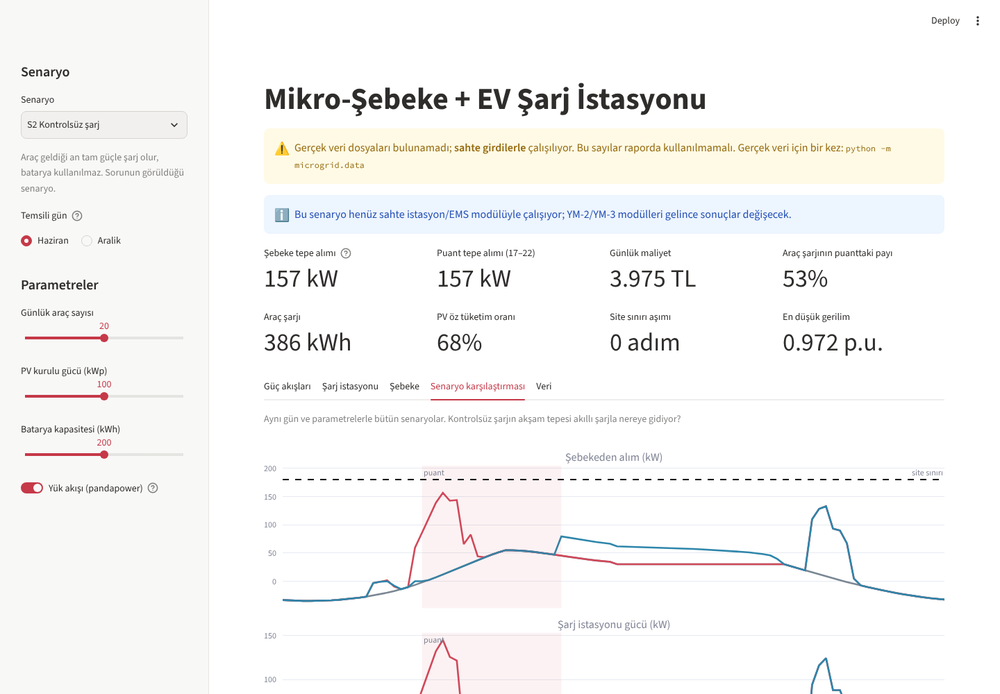

# Hafta 6 · YM-4 (Entegrasyon) · KPI kartları ve senaryo karşılaştırması

## Bu hafta yapılanlar

- **KPI kartları.** Dashboard'un üstündeki 8 kart, YM-1'in KPI modülünden (`microgrid.kpi.compute`) besleniyor:
  şebeke tepe alımı, puant tepe alımı, günlük maliyet, araç şarjının puanttaki payı, araç şarjı, PV öz tüketimi,
  site sınırı aşımı, en düşük gerilim. Akıllı bir senaryo seçilince her kart S2'ye (kontrolsüz) göre farkı gösteriyor;
  düşmesi iyi olan göstergeler (tepe, maliyet) yeşil.
- **Senaryo karşılaştırması sekmesi.** Aynı gün ve parametrelerle bütün senaryolar: şebeke alımı ve istasyon gücü
  üst üste, altında KPI tablosu (CSV olarak indirilebilir). Sunumdaki "kontrolsüz vs. akıllı şarj" grafiği bu.
- **Geçici referans akıllı şarj (S3, `CheapHoursEMS`).** YM-3'ün EMS'i henüz döngüye bağlanmadığı için
  karşılaştırmanın uçtan uca çalıştığını göstermek üzere basit bir kural yazıldı. Araç şarjını gece tarifesine
  kaydırıyor, PV fazlasını kullanıyor, istasyon ve site sınırlarına uyuyor; bataryayı kullanmıyor.
  **YM-3'ün kural tabanlı EMS'i geldiğinde S3 onunla değiştirilecek.** Bu sınıf YM-3 için kıyas noktası olarak kalabilir.

## Kanıt

| Sahte girdiler, Haziran | S1 Temel | S2 Kontrolsüz | S3 Akıllı (geçici) |
| --- | --- | --- | --- |
| Şebeke tepe alımı | 55 kW | 157 kW (17:45) | 133 kW (07:30) |
| Puant (17–22) tepe alımı | 55 kW | 157 kW | 55 kW |
| Araç şarjının puanttaki payı | — | %53 | %0,2 |
| Günlük maliyet | 2.016 TL | 3.975 TL | 3.294 TL (−%17) |
| Verilen araç enerjisi | 0 | 386 kWh | 386 kWh |

*(Sahte girdi ve sahte istasyonla; gerçek veriyle sayılar değişir. Rapordaki asıl sayılar YM-1'in gerçek veri çalıştırmalarından alınmalı.)*

## Bulgu: "rebound peak"

S3'ün ilk sürümü araçları gece tarifesi başlar başlamaz (22:00) tam güçle şarj ediyordu. Puanttan kaçıldı ama
**22:00'de 180 kW'lık yeni bir tepe** oluştu (S2'deki 157 kW'tan bile yüksek, site sınırına dayanmış).
Bu literatürde bilinen bir sorun: herkes aynı fiyat sinyaline aynı anda tepki verince tepe yok olmuyor, kayıyor.
Çözüm olarak her aracın ihtiyacı ayrılışına kadar kalan gece saatlerine eşit yayıldı. Bu kez tepe 22:00'de
oluşmadı. **YM-3 için not:** kural tabanlı EMS'te de tarife sınırında aynı tuzağa dikkat edilmeli. Sunumda
"neden basit zaman kaydırma yetmez" sorusuna iyi bir örnek.

## Sınırlama

S3'te sabah 07:30'daki 133 kW'lık tepe, sahte istasyonun bilinen sorunundan kaynaklanıyor: akşam ünite bulamayan
araçlar sabah üniteler boşalınca bağlanıyor ve gece tarifesi bitmiş olduğu için kalan sürede şarj olmak zorunda
kalıyor. YM-2'nin istasyon modeli gelince yeniden değerlendirilecek.

## Gelecek hafta

- Simulink CSV'lerini (D1–D3) dashboard'a almak.
