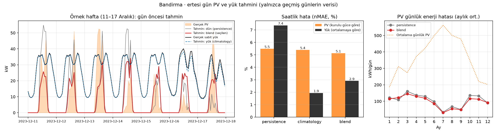

# Hafta 7 · YM-1 (Veri katmanı) · Ertesi gün tahmin girdileri

## Bu hafta yapılanlar

- **Ertesi gün PV ve yük tahmini** (`src/microgrid/data/forecast.py`). Optimizasyonlu EMS (YM-3, Senaryo 5) günü
  başında planlar; plana gerçek değerler değil tahmin girmeli, yoksa optimizasyonun başarısı olduğundan iyi görünür.
  Tahminler yalnızca geçmiş günlerin verisini kullanıyor:
  - **persistence:** dünün aynı saati.
  - **climatology:** son 7 günün aynı saatteki ortalaması; yükte yalnızca aynı gün tipinden (hafta içi / cumartesi /
    pazar + resmî tatil).
  - **blend:** %30 persistence + %70 climatology.
  - **perfect:** gerçek değer (karşılaştırma için üst sınır).
  - Fiyat tahmin edilmiyor: üç zamanlı tarife önceden bilinir.
- **Seçim** (config `forecast`): PV için blend, yük için climatology. Yöntem ve pencere (7 / 14 / 28 gün)
  yıl boyu hata karşılaştırmasıyla seçildi.
- **`forecast_inputs(cfg, index)`:** EMS'in `prepare()` ile göreceği tablo; `build_inputs` ile aynı indeks ve sütunlar.
- **Döngüye ekleme (YM-4 dosyası, geriye uyumlu):** `run(..., forecast=...)` verilirse EMS'in `prepare()`'i tahmini görür,
  adımlar gerçek girdilerle ilerler. Verilmezse eskisi gibi gerçek girdi (kusursuz tahmin).
- **Testler:** yöntemlerin yalnızca geçmişi kullanması, gün tipleri ve tatiller, perfect = gerçek girdi, seçilen
  yöntemlerin persistence'tan iyi olması, döngünün tahmini EMS'e iletmesi. 6 yeni test, toplam 46.

## Kanıt



**Yıl boyu saatlik tahmin hatası (gün öncesi):**

| | persistence | climatology | **blend** |
| --- | --- | --- | --- |
| PV nMAE (kurulu güce göre) | %5,5 | %5,4 | **%5,1** |
| PV RMSE | 13,3 kW | 11,4 kW | **11,1 kW** |
| PV günlük enerji hatası | 105 kWh | 105 kWh | **97 kWh** |
| Yük nMAE (ortalamaya göre) | %7,4 | **%1,9** | %2,9 |

**Yorum:**
- PV tahmininin zorluğu havada: günlük ortalama PV 365 kWh iken günlük hata ~97 kWh. Yazın hata küçük (Temmuz ~30 kWh/gün,
  hava hep açık), kışın büyük (Aralık ~90 kWh/gün, ortalama günlük üretimin yarısı). Kışın optimizasyon PV'ye güvenerek
  plan yaparsa yanılabilir; MILP'in bataryayı ve şarjı biraz ihtiyatlı planlaması gerekecek.
- Yük tahmini çok iyi görünüyor (%2), ama bunun sebebi yük verisinin standart BDEW profili olması: profil yalnızca
  mevsim ve gün tipine göre değişiyor, gerçek sayaç verisinin günlük dalgalanması yok. Gerçek bir sitede hata
  daha yüksek olur. Raporda bu şekilde belirtilmeli.

## YM-3 için kullanım

```python
from microgrid.data.forecast import forecast_inputs
result = run(cfg, build_inputs(cfg, index), station, ems, battery, grid, forecast=forecast_inputs(cfg, index))
```

Tahmin gerçek tarihli simülasyonda anlamlı (`inputs.mode: actual`). Temsili gün modunda girdinin kendisi ortalama
olduğu için ayrıca tahmin gerekmez. Senaryo 5'te "perfect" ve "blend" ile iki kez çalıştırıp farkı göstermek,
tahmin hatasının optimizasyona maliyetini ölçer.

## Gelecek hafta

- Senaryolar arası karşılaştırma tablosu (Hafta 8).
