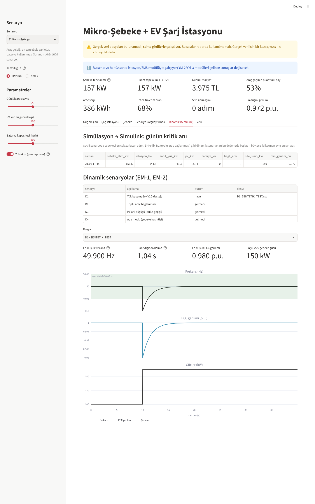

# Hafta 7 · YM-4 (Entegrasyon) · Simulink çıktılarının dashboard'a alınması

## Bu hafta yapılanlar

- **Dinamik (Simulink) sekmesi.** EM ekibinin `simulink/outputs/` altına koyduğu CSV'ler dashboard'da otomatik görünüyor:
  - **D1–D4 durum tablosu:** plandaki her dinamik senaryo için *hazır / hatalı / gelmedi*. Perşembe raporundaki
    EM satırı doğrudan buradan okunabilir.
  - Dosya seçilince: en düşük frekans (Hz) ve anı, **frekans bandı dışında kalma süresi** (MathWorks örneğindeki
    0,999–1,001 p.u. = 49,95–50,05 Hz), en düşük PCC gerilimi, en yüksek şebeke gücü; frekans (bant gölgeli),
    PCC gerilimi ve güçler (şebeke, istasyon AC/DC, batarya, PV, yük) grafiği.
  - Hatalı dosya dashboard'u çökertmiyor. Neyin yanlış olduğu yazıyor (ör. "freq_pu … Hz ise 50'ye bölün",
    "dosya adı `D1_yuk_basamagi.csv` kuralına uymuyor").
- **Python → Simulink köprüsü: "günün kritik anı".** Seçili senaryoda şebekeyi en çok zorlayan adım ve o anın
  güçleri (istasyon, sabit yük, PV, batarya, bağlı araç sayısı) tablo olarak veriliyor. Planda "Python kritik anı
  bulur, Simulink o anı dinamik inceler" diye geçen adım bu. EM ekibi D2'yi bu değerlerle başlatmalı.
- **Config:** `simulink.outputs_dir` ve `simulink.freq_band_pu` (bant koda gömülü değil).
- **Testler:** katalog (hazır/hatalı/gelmedi, yanlış adlı dosya), banttan çıkış süresinin analitik değerle
  karşılaştırılması (üstel toparlanmada 1,5·ln2 ≈ 1,04 s), kritik anın en yüksek alım olması.

## Kanıt

**Uyarı: bu ekran görüntüsündeki D1 grafiği gerçek Simulink sonucu değildir.** Sekmenin çalıştığını göstermek için
testlerdeki sentetik sinyalle (`D1_SENTETIK_TEST.csv`, t = 10 s'de 0,1 Hz düşüş ve üstel toparlanma) alındı;
dosya repoya konmadı. Gerçek D1–D4 CSV'leri henüz gelmedi.

## EM ekibinden beklenen (D1–D3 Hafta 5–7 planındaydı)

| | Durum |
| --- | --- |
| D1 yük basamağı + V2G | gelmedi |
| D2 toplu araç bağlanması | gelmedi. Kritik an: Haziran S2'de 17:45, istasyon ~145 kW (sahte girdiyle; gerçek veriyle tablo dashboard'da) |
| D3 PV ani düşüşü | gelmedi |

CSV formatı: `docs/arayuz-sozlesmesi.md` bölüm 5; GitHub'a web arayüzünden yükleme: `docs/calisma-duzeni.md`.

## Gelecek hafta (Hafta 8)

- Dashboard'da bütün senaryolar (YM-2/YM-3 modülleri gelirse S3–S6), hata düzeltme.
