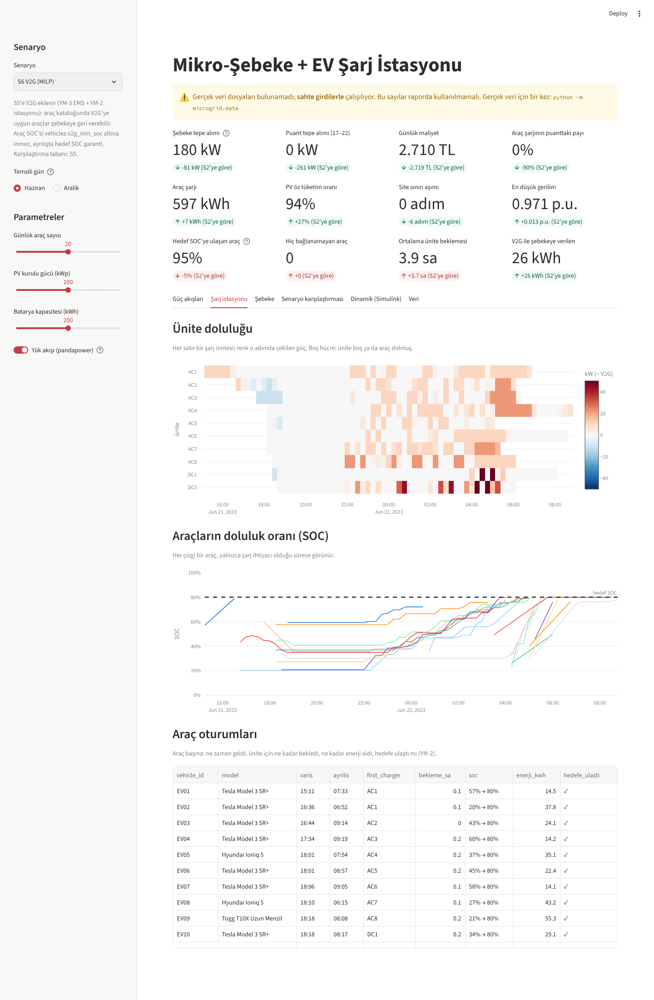
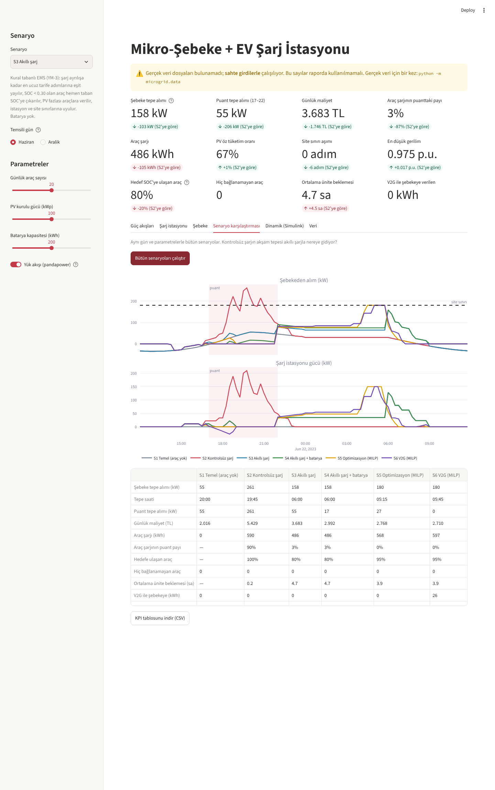

# Hafta 8 · YM-4 (Entegrasyon) · Bütün senaryolar dashboard'da, hata düzeltme

## Bu hafta yapılanlar

- **Entegrasyon (PR #15–#18).** YM-1'in mevsim profilleri, YM-2'nin gerçek şarj istasyonu ve YM-3'ün EMS'i
  (kural tabanlı, batarya, MILP, V2G) main'de. #16 ile #17 çakışıyordu; #18'de çözüldü. Artık **altı senaryonun hepsi
  gerçek istasyon ve gerçek EMS ile çalışıyor**, hiçbiri "geçici" değil.
- **Entegrasyonda bulunan hatalar:**
  1. *Şarj verimi:* YM-3'ün kural tabanlı EMS'i istasyonun %95 verimini hesaba katmıyordu (sahte istasyon kayıpsızdı).
     S3'te 20 araçtan yalnızca 11'i hedefe ulaşıyordu ve S3 bu yüzden yanıltıcı biçimde ucuz görünüyordu. Düzeltildi (#18): 16/20.
  2. *Sınır aşımı sayımı:* MILP çözümü sınıra çözücü toleransı kadar (~0,0000005 kW) taşabiliyor; KPI modülü bunu
     "site sınırı aşımı" sayıyordu (S5'te 3 adım). Aşım eşiği 1 W yapıldı (`kpi.LIMIT_TOL_KW`); gerçek aşımlar (S2) sayılmaya devam ediyor.
- **Dashboard:**
  - Üçüncü KPI satırı (istasyon ve kullanıcı, YM-2): hedef SOC'ye ulaşan araç, hiç bağlanamayan araç, ortalama ünite
    beklemesi, V2G ile şebekeye verilen enerji. Göstergelerin tek kaynağı `sim/sonuclar.py` (dashboard ve rapor aynı sayıyı gösterir).
  - **Araç oturumları tablosu:** araç başına model, varış/ayrılış, bekleme, SOC (geliş → ayrılış), enerji, hedefe ulaştı mı.
  - **V2G görünür:** ısı haritası V2G'de iki yönlü renk kullanıyor (kırmızı şarj, mavi araçtan şebekeye).
  - **Karşılaştırma butonla:** 6 senaryo yük akışıyla ilk seferde ~40 s sürüyor (MILP senaryoları 9–14 s). Artık
    "Bütün senaryoları çalıştır" butonu ve ilerleme çubuğu var; sonra önbellekten anında geliyor.
  - `?senaryo=S6` gibi bağlantılarla doğrudan bir senaryoya açılıyor (demo için).
- **Rapordaki sayıların tek kaynağı:** `python -m microgrid.sim.sonuclar` bütün senaryoları iki temsili günde yük
  akışıyla çalıştırıp KPI tabloları (`kpi_<gün>.csv`), rapora hazır `ozet.md` ve karşılaştırma grafiklerini üretiyor.
  GitHub'da **Actions → sonuclar → Run workflow** ile gerçek PVGIS verisiyle çalışıyor, çıktılar indirilebilir dosya
  olarak kalıyor. Her tabloda girdi kaynağı (gerçek / sahte) yazıyor.

## Kanıt

*(Ekran görüntüleri bu ortamda sahte girdilerle alındı; gerçek veri sonuçları `sonuclar` iş akışından alınacak.)*

## Bulgu: akıllı şarjın tepesi sabaha kayıyor

Akıllı senaryoların hepsi puanttaki (17–22) şarjı sıfıra yakın indiriyor. Ama MILP (S5, S6) maliyeti en aza
indirirken şarjı gece tarifesinin bittiği 06:00'dan hemen önceye topluyor ve **05:00–06:00 arasında site sınırına
(180 kW) dayanıyor**. 6. haftada gördüğümüz "rebound peak"in bir başka biçimi: tepe yok olmuyor, tarife sınırına
kayıyor. Sunumda "maliyeti en aza indirmek ile tepeyi en aza indirmek aynı şey değil" diye anlatılabilir.
YM-3 için: MILP amaç fonksiyonundaki tepe ağırlığı artırılarak denenebilir.

## Açık kalanlar

- **YM-3:** S3/S4'te 4 araç ünite sırası yüzünden hedefe ulaşmıyor (ortalama bekleme 4,7 sa); test `xfail`.
- **EM-1:** S2'de istasyon 150 kW sınırını ve site sınırını aşıyor. Kontrolsüz şarjın böyle mi modelleneceği netleşmeli.
- **EM-1/EM-2:** Simulink D1–D4 CSV'leri hâlâ gelmedi.

## Gelecek hafta (Hafta 9)

- README, kod temizliği, demo akışı; 9 Aralık kod dondurma.
