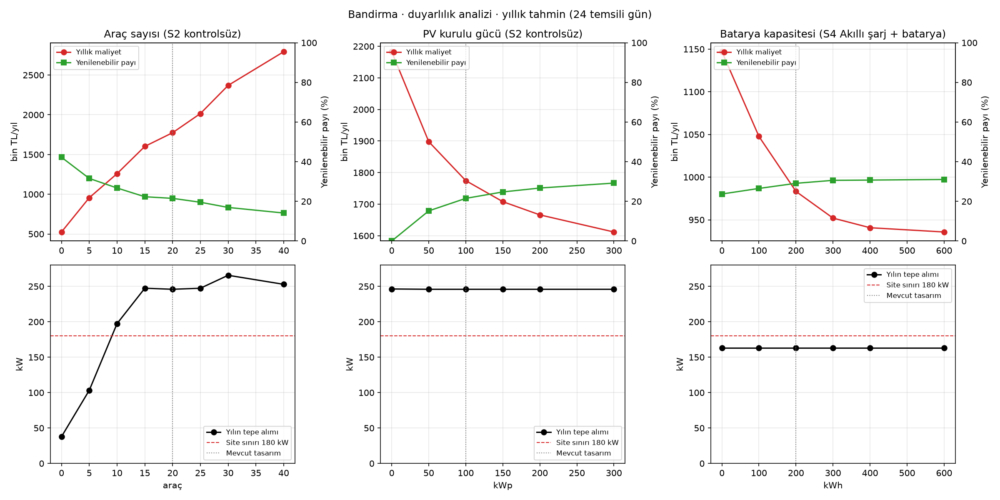

# Hafta 8–9 · YM-1 (Veri katmanı) · Senaryo tablosu ve duyarlılık analizi

Sonuçlar YM-2'nin gerçek şarj istasyonu (#17) ve YM-3'ün EMS'i ile bataryası (#16, #18) üzerinde, yıllık
(24 temsili gün) hesaplanmıştır.

## Bu hafta yapılanlar

- **Analiz modülü** (`src/microgrid/analysis.py`): bir senaryo 24 temsili günde çalıştırılıp yıllık KPI'ya çevriliyor.
  `scenario_table` senaryoları, `sweep` bir parametrenin değerlerini karşılaştırıyor. Senaryo tanımı ve listesi
  YM-4'ün `sim/scenarios.py` dosyasından geliyor; dashboard ile rapor tablosu aynı senaryoları gösteriyor.
  - **Döngüsel batarya:** her temsili gün, bataryanın bir önceki çalıştırmada bittiği doluluk ile başlıyor
    (gün 2 kez ısınma için tekrarlanıyor). Yapılmasaydı batarya her gün %50 dolu başlar ve boşalttığı enerji
    her gün bedavaya geri gelirdi; ilk denemede yıllık tasarruf bu yüzden ~2 kat büyük çıkmıştı.
- **Hafta 8, senaryo tablosu** (`scripts/ym1_hafta8_senaryolar.py` → [hafta8-ym1-senaryolar.md](hafta8-ym1-senaryolar.md)):
  S1–S6 yıllık, pandapower ile.
- **Hafta 9, duyarlılık analizi** (`scripts/ym1_hafta9_duyarlilik.py`): araç sayısı, PV gücü, batarya kapasitesi.
- **Testler:** senaryo tablosu, ortak senaryo listesinin yıllık çalışması, duyarlılık, döngüsel bataryanın bedava enerji
  vermemesi.

## Senaryo tablosu (yıllık)

| | S1 Araç yok | S2 Kontrolsüz | S3 Akıllı şarj | S4 + Batarya | S5 MILP | S6 V2G |
| --- | --- | --- | --- | --- | --- | --- |
| Yıllık maliyet | 525 bin TL | 1.775 bin TL | 1.147 bin TL | 983 bin TL | 911 bin TL | 910 bin TL |
| Yılın tepe alımı | 38 kW | 246 kW | 163 kW | 163 kW | 180 kW | 180 kW |
| Araçlara verilen enerji | — | 215 MWh | 177 MWh | 177 MWh | 204 MWh | 206 MWh |
| Araç şarjının puant payı | — | %90 | %3 | %3 | %2 | %2 |
| Site sınırı (180 kW) aşımı | 0 | 14,6 MWh | 0 | 0 | 0 | 0 |
| En yüksek kablo yüklenmesi | %28 | **%117** | %81 | %81 | %94 | %94 |

**Yorum:**
- **Kontrolsüz şarj (S2) sistemi aşıyor:** araçların %90'ı puantta şarj oluyor, tepe 246 kW (19:45, kış hafta içi),
  site sınırı yılda 14,6 MWh aşılıyor ve otopark kablosu %117 yükleniyor. En düşük gerilim 0,96 p.u. (sınır 0,95).
- **Akıllı yönetim maliyeti yarıya yakın düşürüyor:** S5 (MILP) yıllık maliyeti 1,77 milyon TL'den 911 bin TL'ye
  indiriyor (%−49), puantta alım neredeyse sıfır, hiçbir sınır aşılmıyor.
- **Adil karşılaştırma için:** S3/S4 araçlara S2'den %18 daha az enerji veriyor; maliyet farkının bir kısmı bundan.
  S5 ise S2'ye yakın enerji (%95) verip en düşük maliyeti sağlıyor. Kullanıcı memnuniyeti (hedef SOC'ye ulaşma)
  YM-2'nin raporunda.
- **Yeni tepe gece:** akıllı şarj yükü ucuz gece dilimine taşıyınca tepe akşamdan gece/sabaha kayıyor (S3/S4 06:00,
  S5/S6 ~05:00). S5'te tepe tam 180 kW: MILP gece ucuz saatte site sınırına kadar çekiyor. Sınır aşılmıyor ama
  kablo %94 yükleniyor.
- **V2G (S6) yıllık maliyette çok küçük fark** (~370 TL/yıl) yaratıyor: S5 puantta alımı zaten 545 kWh/yıla
  indirmiş, V2G'nin karşılayacağı pahalı yük neredeyse kalmamış. V2G'nin değeri bu sitede maliyetten çok
  dinamik destekte (frekans, ada modu; EM-1/EM-2'nin Simulink senaryoları).

## Duyarlılık analizi

| Parametre (mevcut değer) | Bulgu |
| --- | --- |
| **Araç sayısı** (20, kontrolsüz) | **Site sınırı 10 araçta aşılıyor** (tepe 197 kW). 15 araçtan sonra tepe ~246 kW'ta doyuyor (10 ünite dolu); maliyet artmaya devam ediyor (sırada bekleyen araçlar nöbetleşe şarj oluyor). |
| **PV gücü** (100 kWp, kontrolsüz) | 100 → 200 kWp yıllık maliyeti %6 (108 bin TL) düşürüyor; **tepe yükü ve sınır aşımını değiştirmiyor** (tepe akşam, PV yokken). |
| **Batarya** (200 kWh, S4) | 0 → 200 kWh yıllık ~164 bin TL tasarruf; 300 kWh'ten sonra doyuyor (~952 bin TL). **Tepe yük değişmiyor** (163 kW): tepe gece araç şarjından geliyor, batarya puant yükü için çalışıyor. |

**Sonuç:** Kontrolsüz şarjda mevcut tasarım (20 araç) site sınırını aşıyor; çözüm PV veya batarya değil, şarjı zamanda
kaydırmak. Bu yapıldığında (S3–S6) sınır aşılmıyor ve maliyet %35–49 düşüyor. Batarya ek olarak ~%14 tasarruf sağlıyor.

## Sınırlamalar

- Yıllık değerler 24 temsili günden; tam yıla göre ~%3 düşük (Hafta 6).
- Duyarlılık noktalarında hız için yük akışı yok; gerilim/yüklenme senaryo tablosunda.
- Batarya 0 kWh noktası "batarya yok" olarak hesaplanıyor (YM-3'ün bataryası 0 kapasiteyi kabul etmiyor).
