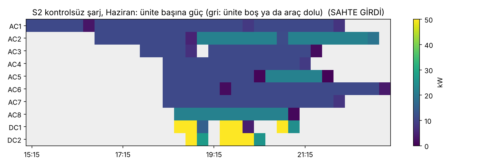

# Hafta 9 · YM-2 (Şarj istasyonu) · Rapor bölümü

Rapor: 10 Aralık 2026. 9 Aralık kod dondurmadan önce istasyon kodu tamamlandı.

## Bu hafta yapılanlar

- **Rapor bölümü taslağı:** `docs/rapor/sarj-istasyonu.md` (istasyon tanımı, talep modeli, atama ve nöbetleşe
  şarj, CC-CV, döngüdeki yeri, V2G kuralı, sonuçlar, sınırlamalar).
- **Grafikler:** `scripts/ym2_rapor_grafikleri.py` → CC-CV eğrisi, ünite doluluğu ısı haritası, memnuniyet tablosu.
- **Tasarım belgeleri güncellendi:** `docs/SINIF_DIYAGRAMI.md` (Mermaid diyagramı + Hafta 2'den farklar),
  `docs/PARAMETRE_TABLOSU_VE_ARAYUZ.md` (eski imzalar yerine `requests/apply` özeti, güncel sınırlar).

## Kanıt

## Açık işler

- Sayılar sahte girdiyle; gerçek veriyle iki betik yeniden çalıştırılıp rapor tabloları güncellenmeli.
- YM-3'ün S3–S6 sonuçları gelince memnuniyet tablosuna eklenecek.

## Gelecek hafta (Hafta 10)

- Rapor bölümünün son hâli, sunumun istasyon slaytları.
