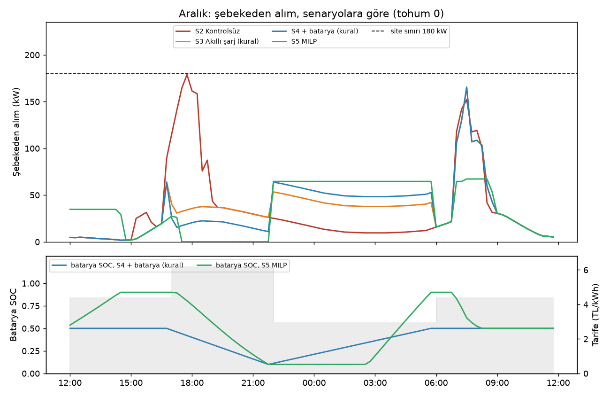

# Hafta 9 · YM-3 (EMS ve optimizasyon) · Rapor bölümü ve sonuçlar

Kod: `src/microgrid/ems/` · Ayrıntılı tasarım: [../ems.md](../ems.md) · Sayılar `python scripts/ym3_hafta9_sonuclar.py` ile üretilir.

## Bu hafta yapılanlar

- **Rapor bölümü** (aşağıda): yöntem, S2–S6 sonuçları, duyarlılık ve sınırlamalar.
- **Sonuç scripti** (`scripts/ym3_hafta9_sonuclar.py`): iki temsili günde (Haziran, Aralık) gerçek veriyle S2–S6'yı 5 araç filosu
  (tohum) için çalıştırır; tablo ve grafik üretir.
- **V2G aşınma bedeli** ve **tahmin hatası** duyarlılıkları (aşağıda).

## Yöntem

Üç EMS seviyesi aynı arayüzle (`prepare` / `decide`) döngüye takılır:

| Seviye | Senaryo | Ne yapar |
| --- | --- | --- |
| Kontrolsüz (v0) | S2 | Araç geldiği an tam güç, batarya yok |
| Kural tabanlı | S3, S4 | Şarjı ayrılışa kadar en ucuz tarife adımlarına eşit yayar; SOC < 0.30 olan araç hemen taban SOC'ye çıkar; PV fazlası araçlara gider; istasyon (150 kW) ve site (180 kW) sınırlarına uyar. S4'te batarya: site sınırı → PV fazlası → puantta deşarj → gece ucuz tarifeyle şarj |
| Optimizasyon | S5, S6 | Kayan ufuklu MILP (PuLP/CBC): her adımda bağlı araçlarla gün sonuna kadar maliyeti en aza indirir, ilk adımı uygular |

S6, V2G'yi ekler (araçların %40'ı, 11 kW): araç SOC'si 0.30 altına inmez, ayrılışta hedef SOC (0.80) garanti.

MILP'in amaç fonksiyonu: Σ fiyat · alım · dt + 0.2 TL/kW · tepe alım + batarya ve V2G aşınma bedeli + ceza terimleri.
Tepe terimi küçüktür: maliyet aynı olan çözümler arasında düz olanı seçtirir.

## Sonuçlar

Gerçek veri (PVGIS + BDEW + EPDK), temsili gün, 20 araç / 10 ünite, 5 farklı filo ortalaması (± standart sapma).
Bütün senaryolar aynı istasyonla çalıştı (V2G yalnızca S6'da açık). Site sınırı 180 kW, istasyon sınırı 150 kW.

### Haziran

| Senaryo | Maliyet (TL) | Δ maliyet | Tepe alım (kW) | Δ tepe | Puant şarj payı | Öz tüketim | Gün sonu SOC | V2G (kWh) |
| --- | ---: | ---: | ---: | ---: | ---: | ---: | ---: | ---: |
| S2 Kontrolsüz | 2379 ± 259 | +0% | 178 | +0% | 0.59 | 0.63 | 0.50 | 0 |
| S3 Akıllı şarj (kural) | 1808 ± 210 | -24% | 90 | -49% | 0.02 | 0.63 | 0.50 | 0 |
| S4 + batarya (kural) | 1343 ± 212 | -44% | 90 | -49% | 0.02 | 0.90 | 0.78 | 0 |
| S5 MILP | 1138 ± 210 | -52% | 58 | -67% | 0.07 | 0.90 | 0.50 | 0 |
| S6k V2G (kural) | 1343 ± 212 | -44% | 90 | -49% | 0.02 | 0.90 | 0.78 | 0 |
| S6 V2G (MILP) | 1138 ± 210 | -52% | 59 | -67% | 0.07 | 0.90 | 0.50 | 0 |

### Aralık

| Senaryo | Maliyet (TL) | Δ maliyet | Tepe alım (kW) | Δ tepe | Puant şarj payı | Öz tüketim | Gün sonu SOC | V2G (kWh) |
| --- | ---: | ---: | ---: | ---: | ---: | ---: | ---: | ---: |
| S2 Kontrolsüz | 3696 ± 243 | +0% | 208 | +0% | 0.59 | 1.00 | 0.50 | 0 |
| S3 Akıllı şarj (kural) | 3076 ± 224 | -17% | 107 | -49% | 0.01 | 1.00 | 0.50 | 0 |
| S4 + batarya (kural) | 2854 ± 224 | -23% | 107 | -49% | 0.01 | 1.00 | 0.50 | 0 |
| S5 MILP | 2656 ± 220 | -28% | 67 | -68% | 0.00 | 1.00 | 0.50 | 0 |
| S6k V2G (kural) | 2753 ± 209 | -26% | 107 | -49% | 0.00 | 1.00 | 0.50 | 32 |
| S6 V2G (MILP) | 2633 ± 204 | -29% | 68 | -67% | 0.00 | 1.00 | 0.50 | 8 |

### Duyarlılık: V2G aşınma bedeli (Aralık, tohum 0, S6 MILP)

| Aşınma (TL/kWh) | Maliyet (TL) | V2G (kWh) |
| ---: | ---: | ---: |
| 0.0 | 2941 | 38 |
| 0.5 | 2945 | 13 |
| 1.0 | 2945 | 13 |
| 2.0 | 2949 | 11 |
| 4.0 | 2983 | 0 |

### Duyarlılık: tahmin hatası (gerçek tarih 20 Aralık 2023, S5 MILP, 5 filo ortalaması)

| Tahmin | Maliyet (TL) | Tepe alım (kW) |
| --- | ---: | ---: |
| Kusursuz | 2381 | 67 |
| YM-1 `blend` tahmini | 2512 | 66 |
| (Karşılaştırma: S4 kural tabanlı) | 2502 | 107 |

## Yorum

1. **Akıllı şarjın asıl kazancı tepe yükte.** Kural tabanlı S3 tek başına, aynı enerjiyi vererek tepe alımı iki mevcut günde de
   yaklaşık yarıya indirir (Aralık 208 → 107 kW) ve puanttaki araç şarjını sıfıra yakın düşürür (0.59 → 0.01). Kontrolsüz şarjda Aralık tepesi
   5 filo ortalamasında 208 kW, yani 180 kW site sınırının üstünde; akıllı şarj sınırın çok altında kalıyor.
2. **Batarya mevsime göre farklı değer taşıyor.** Haziran'da PV fazlasını saklayıp öz tüketimi 0.63 → 0.90'a çıkarıyor
   (S3 → S4: −%26 maliyet). Aralık'ta PV yok, kazanç yalnızca tarife farkından geliyor (−%7).
   *Not:* Haziran'da S4 günü 0.78 SOC ile bitiriyor (başlangıç 0.50). Bu fazla enerji PV'den geldi ve ücretsiz; ama S4'ün
   S5'ten ucuz ya da pahalı olduğunu söylerken bunu hatırlamak gerekir. MILP gün sonunu başlangıç SOC'sine (0.50) bağlıyor.
3. **MILP, S4'ün (kural + batarya) üstüne maliyette %7 (Aralık) ve %15 (Haziran), tepe alımda %36–37 daha iyi.** Kural yalnızca tarifenin en ucuz ve en pahalı
   dilimini görüyor. MILP öğleden sonra gündüz tarifesinde (4.38 TL) bataryayı doldurup puantta (6.17 TL) boşaltmayı, gecenin
   alımını düz tutmayı ve araç şarjını batarya ile birlikte planlamayı yapabiliyor (grafikte S5 öğleden sonra 35 kW alıp 17:00'de sıfıra iniyor).
4. **V2G bu sitede küçük bir etki.** Aralık'ta MILP'te maliyet −%1 (2656 → 2633 TL), kural tabanlıda −%3.5 (2854 → 2753 TL; kural
   aşınma bedelini bilmiyor). Haziran'da hiç devreye girmiyor çünkü akşam yükünü batarya zaten PV ile doluyken karşılıyor.
   Neden küçük: araçlar eve akşam ortalama 0.20–0.60 SOC ile geliyor ve sabah hedefe (0.80) dolu ayrılmaları gerekiyor; V2G için
   taban (0.30) ile hedef arasındaki dar bantta kalan enerji yetmiyor. Aşınma bedeli 4 TL/kWh'e çıkınca V2G tamamen kapanıyor.
   Gerçek EV batarya aşınması bu aralıkta olabilir; 0.5 TL/kWh **varsayım**, ölçüm değil.
5. **Tahmin hatası MILP'in maliyet kazancını eritiyor, tepe kazancını değil.** Gerçek tarihli günde (20 Aralık) YM-1'in tahmini ile
   MILP kusursuz bilgiye göre %5.5 pahalı (2381 → 2512 TL) ve kural tabanlı S4'ten (2502 TL) pratik olarak farksız. Tepe alım ise
   hâlâ 66 kW'a karşı 107 kW. Bu tek bir gün; genel bir sonuç olarak yazılmamalı.

## Sınırlamalar ve dikkat

- **İstasyon sahte (`MockStation` / `V2GMockStation`).** CC-CV eğrisi, ünite paylaşımı (nöbetleşe şarj) ve YM-2'nin araç
  kataloğu yok. 20 araç / 10 ünite olduğundan geç gelen araçlar ünite boşalana kadar bağlanamıyor; bu yüzden tohuma göre sabah
  07:30 civarında ikinci bir tepe oluşuyor (grafikte görülüyor). YM-2 istasyonu main'e girince sayılar yeniden üretilmeli.
- **V2G parametreleri varsayım:** araçların %40'ı uygun, 11 kW, verim 0.95, taban SOC 0.30, aşınma 0.5 TL/kWh.
- **Şebekeye satış ücretsiz** (`ems.export_price_tl_per_kwh: 0`, açık soru 2). Satış fiyatı gelirse PV fazlasının değeri ve bataryanın
  rolü değişir.
- **Yük profili BDEW standardı;** gerçek sayaç verisinin günlük dalgalanması yok (YM-1 raporu). Yük tahmin hatası bu yüzden olduğundan
  küçük görünüyor.
- **Sonuçlar 5 filo ortalaması;** maliyetteki ±200 TL filoya bağlı. Senaryolar arası farklar bu yayılımdan büyük, ama %1'lik V2G farkı değil.
- **Kayan ufuk MILP'in tek çözümü ≈ 0.06–0.1 sn, tam gün 30–60 sn / 5 filo;** çözücü hata verirse o adım kural tabanlı EMS'e düşüyor
  (bu çalıştırmalarda hiç düşmedi).
- **PuLP < 4.** PuLP 4 CBC'yi içermiyor ve API'yi değiştirdi; `requirements.txt` bu yüzden sürümü sınırlıyor.

## Gelecek hafta

- Rapor ve sunum (Hafta 10): EMS ve optimizasyon bölümü, sunum slaytları.
- YM-2 istasyonu main'e girince S2–S6'yı onunla yeniden çalıştırmak (senaryoda `station=` tek satır).
