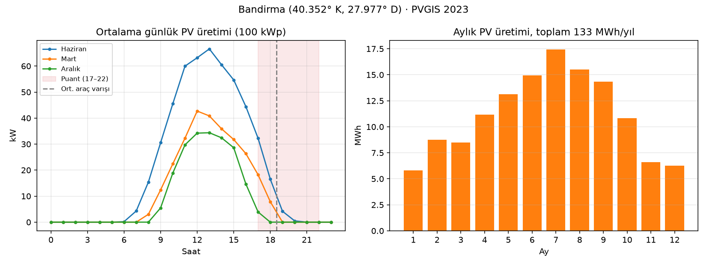
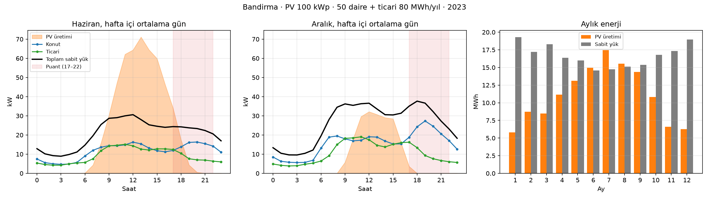

# Veri kaynakları (YM-1)

Hafta 1'de üç kaynağa erişim denendi, Hafta 2'de PV verisi temizlendi ve sabit yük profilleri eklendi. Her biri için nereden geldiği, formatı ve projede nasıl kullanılacağı aşağıda.
Verinin nasıl indirileceği: [data/README.md](../data/README.md).

## Özet

| Veri | Kaynak | Erişim | Durum | Projede kullanan |
| --- | --- | --- | --- | --- |
| Güneş ışınımı / PV üretimi | PVGIS v5.3 (AB JRC) | Açık API, anahtar yok | İndirildi ve temizlendi (Bandırma 2023) | YM-1 PV modeli → EMS, döngü |
| EV şarj oturumları | Caltech ACN-Data | API, ücretsiz token | Kod hazır, token bekleniyor | YM-2 talep modeli |
| Elektrik tarifesi | EPDK üç zamanlı tarife | Elle (EPDK tablosu) | Resmî tablodan doğrulandı (4 Nisan 2026) | YM-3 EMS, YM-1 KPI (maliyet) |
| Sabit yük profilleri | BDEW H0/G0 (demandlib) + Türkiye tatilleri | Paket içinde, internet gerekmez | Hazır, konut + ticari saatlik | YM-1 yük modeli → EMS, pandapower |

## 1. PVGIS: güneş verisi

- **Konum:** Bandırma, 40.352° K, 27.977° D (rakım 43 m). `config/default.yaml → site`.
- **Sorgu:** `seriescalc` uç noktası, 1 kWp sistem, eğim 30°, güneye bakan, %14 kayıp, yıl 2023.
  1 kWp için indirildiği için kurulu güç değişince yeniden indirmek gerekmez: `pv_kw = installed_kw × pv_kw_per_kwp`.
- **Ham format:** JSON, yıl boyunca 8760 saatlik satır.

| PVGIS alanı | Anlamı | Birim | Bizdeki sütun |
| --- | --- | --- | --- |
| `time` | `20230621:0910` biçimi, **UTC** | — | `timestamp` (Türkiye saati, UTC+3) |
| `P` | 1 kWp'lik sistemin AC gücü | W | `pv_kw_per_kwp` (kW/kWp) |
| `G(i)` | Panel düzlemine gelen ışınım | W/m² | `irradiance_w_m2` |
| `T2m` | Hava sıcaklığı | °C | `temp_c` |
| `WS10m` | Rüzgâr hızı (10 m) | m/s | `wind_m_s` |

- **Dikkat edilecekler:**
  - Saatler UTC gelir, `:10` dakikası saatin temsil anıdır. Saate yuvarlayıp Türkiye saatine çeviriyoruz.
    Bu kaymadan dolayı dosya 1 Ocak 03:00'te başlar, son 3 saat 2024'e taşar.
  - Saatlik çözünürlük. Config'deki 15 dk'lık adım için ara değerleme gerekecek (Hafta 3, PV modeli).
  - PVGIS v5.3'te kullanılabilen son yıl 2023.
- **Temizleme (Hafta 2, `pvgis.clean`):** Ham tablo yerel saatte tam bir takvim yılına (8760 saat, 1 Ocak 00:00 – 31 Aralık 23:00)
  getirilir ve `data/processed/pv_bandirma_2023.csv` olarak yazılır. Diğer modüller bu dosyayı kullanır.

| Kontrol | Yapılan | Bandırma 2023'te |
| --- | --- | --- |
| Ertesi yıla taşan saatler | Yılın başındaki boş saatlere kaydırılır (ikisi de gece, PV = 0) | 3 saat |
| Tekrar eden saat | Atılır | 0 |
| Eksik saat | En fazla 3 saatlik boşluk doğrusal doldurulur, daha uzunu hata verir | 0 |
| Negatif değer | Sıfırlanır | 0 |
| Işınım sıfırken üretim | Üretim sıfırlanır | 0 |

  Yani PVGIS verisi zaten temiz geliyor; tek düzeltme saat dilimi kaymasıydı. Kontroller yine de kodda duruyor,
  başka konum veya yıl indirildiğinde sorun varsa raporlanır.
- **İlk sonuçlar (Bandırma, 1 kWp):** yıllık **1332 kWh/kWp**, yani 100 kWp için ~133 MWh/yıl.
  Haziranda ortalama günlük tepe 13:00'te 0,67 kW/kWp, Aralıkta 0,34 kW/kWp.
  Aylık üretim Temmuzda en yüksek (174 kWh/kWp), Ocakta en düşük (58 kWh/kWp).

**Proje açısından anlamı:** Haziranda bile PV üretimi 19:00'da neredeyse sıfıra iniyor.
Site otoparkında araçların ortalama varışı 18:30, puant tarifesi 17–22 arası.
Yani kontrolsüz şarj, PV'nin olmadığı ve elektriğin en pahalı olduğu saate denk geliyor.
Bu durum, kapsam dokümanındaki site otoparkı seçiminin gerekçesini veriyle destekliyor.
Gündüz PV fazlası bataryaya (BESS) aktarılıp akşam kullanılabilir (Senaryo 4).

## 2. ACN-Data: gerçek şarj oturumları

- **Kaynak:** Caltech Adaptive Charging Network, ABD'deki üç sitenin oturumları: `caltech`, `jpl` ve `office001`.
- **Erişim:** `https://ev.caltech.edu/api/v1/sessions/<site>` adresi. Token gerekir; ücretsiz kayıt: https://ev.caltech.edu/register.
  Token, HTTP Basic Auth'da kullanıcı adı olarak verilir, şifre boş bırakılır. Tokensiz istek `401` döner (denendi).
  Sayfa başına 25 oturum gelir, sonraki sayfa `_links.next` alanında.
- **Önemli alanlar:**

| Alan | Anlamı | Birim / format |
| --- | --- | --- |
| `connectionTime` | Aracın takıldığı an | RFC 1123, **UTC** |
| `disconnectTime` | Aracın çıkarıldığı an | RFC 1123, UTC |
| `doneChargingTime` | Şarjın bittiği an | RFC 1123, UTC |
| `kWhDelivered` | Verilen enerji | kWh |
| `timezone` | Sitenin saat dilimi (UTC'den çevirmek için) | ör. `America/Los_Angeles` |
| `userInputs[].kWhRequested`, `requestedDeparture` | Kullanıcının istediği enerji ve ayrılış (mobil uygulamadan) | kWh, tarih |

- **Kod:** `microgrid.data.acn.sessions_to_frame` oturumları talep modeline uygun sütunlara indirir:
  varış saati (yerel), kalış süresi (saat), verilen ve istenen enerji.
- **Dikkat edilecekler:**
  - Veri **işyeri** otoparkları (sabah gelip akşam ayrılma) içindir. Bizim site otoparkımızda (akşam gelip sabah ayrılma)
    varış saatleri doğrudan kullanılamaz. Kalış süresi ve enerji ihtiyacı dağılımları ise kullanılabilir.
    Öneri: varış/ayrılış saatleri için config'deki Normal dağılımı kullanmak, enerji ihtiyacını ACN'den almak (YM-2 ile konuşulacak).
  - Web arayüzünden 10 Ekim 2019 öncesi indirilen dosyalarda 7–8 saatlik kayma var. API'de bu sorun yok.

## 3. EPDK tarifesi

- **Kaynak:** EPDK "4 Nisan 2026 Tarihinden İtibaren Geçerli Vergiler Hariç Elektrik Tarifeleri" tablosu (resmî, elle indirildi).
- **Satır:** Dağıtım sistemi kullanıcıları → AG tek terim → **Mesken (8 kWh/gün üstü)**, çok zamanlı.
  Sitenin günlük tüketimi 8 kWh'nin çok üstünde olduğu için üst kademe. (Çok zamanlı enerji bedeli iki kademede de aynı.)
- **Fiyat = aktif enerji bedeli + dağıtım bedeli.** Tablonun notuna göre vergiler hariç perakende fiyat bu ikisinin toplamıdır.

| Dilim | Saat | Enerji (kr/kWh) | Dağıtım (kr/kWh) | Toplam (TL/kWh) |
| --- | --- | --- | --- | --- |
| Gündüz | 06–17 | 195,0640 | 242,4900 | 4,3755 |
| Puant | 17–22 | 374,7551 | 242,4900 | 6,1725 |
| Gece | 22–06 | 51,3656 | 242,4900 | 2,9386 |

- **Saatler:** Tablo notuna göre sürekli yaz saatine göre güncellenmiş sayaçlarda yıl boyunca 06–17 / 17–22 / 22–06 geçerli.
  Türkiye 2016'dan beri sürekli UTC+3 kullandığı için bu dilimleri alıyoruz. (Güncellenmemiş eski sayaçlarda Mart–Ekim arası 07–18 / 18–23 / 23–07.)
- İlk girilen ikincil kaynak değerleri (4,38 / 6,17 / 2,94) bu tabloyla örtüşüyor; config'e tablodaki hassas değerler yazıldı.
- **Tarife grubu:** Mesken (site otoparkı, sitenin ortak aboneliği). Ticarethane istenirse yalnızca config değişir.
- Vergiler (KDV, BTV) dahil edilmedi. Senaryolar arası karşılaştırmada oranlar değişmediği için sade tutuldu.
- Gece fiyatı puantın yaklaşık yarısı (2,94 / 6,17 ≈ 0,48). Akıllı şarjın tasarrufu buradan gelecek.

## 4. Sabit yük profilleri (konut + ticari)

Site otoparkının bağlı olduğu binaların (daireler, ortak alanlar, küçük dükkânlar) saatlik tüketimi.

- **Kaynak:** BDEW (Alman Enerji ve Su Birliği) standart yük profilleri, `demandlib` Python paketiyle üretilir.
  Dağıtım şirketlerinin saatlik sayacı olmayan aboneler için kullandığı, yaygın kabul görmüş profillerdir.
  - **H0 (konut):** sabah ve akşam tepeli. Mevsime göre değişen dinamik katsayı uygulanır (`h0_dyn`): kışın tüketim yazdan yüksek.
  - **G0 (genel ticari):** mesai saatlerinde yüksek, hafta sonu ve tatilde düşük.
  - Hafta içi / cumartesi / pazar ayrımı ve kış / yaz / geçiş dönemi profilleri vardır. Çözünürlük 15 dk, biz saatliğe ortalıyoruz.
- **Türkiye'ye uyarlama:** Resmî tatiller (`holidays` paketi, 2023: Ramazan ve Kurban bayramları dahil 13 gün) pazar gibi işlenir.
  Türkiye yaz saati uygulamadığı için saatler doğrudan yerel saat kabul edilir.
- **Ölçek (`config/default.yaml → loads`, EM-1 kararı):** 50 daire × 2400 kWh/yıl = 120 MWh (konut),
  ortak alan ve dükkânlar 80 MWh/yıl. Toplam 200 MWh/yıl, araç şarjı hariç.
  Daire başına 2400 kWh bir başlangıç varsayımı; değişirse yalnızca config değişir.
- **Çıktı:** `data/processed/yuk_profilleri_2023.csv`, sütunlar `residential_kw`, `commercial_kw`, `total_kw` (kW, saatlik ortalama güç;
  saatlik olduğu için değer aynı zamanda o saatin kWh'idir).
- **Temsili gün:** `loads.average_day(df, months=[6], weekdays=[0,1,2,3,4])` seçilen ay ve günlerin 24 saatlik ortalamasını verir.
  PV tablosu için de çalışır. v0 için temsili gün kararı verilince doğrudan kullanılabilir.
- **Dikkat edilecekler:**
  - Profil şekli Almanya'daki tüketim alışkanlıklarından gelir. Türkiye'de akşam tepesi biraz daha geç olabilir ve yaz klima yükü
    profilde yok. Hocaya sorulacak (aşağıda).
  - Isınma elektrikle değil doğalgazla yapıldığı varsayılıyor (BDEW H0 da öyle).

**İlk sonuçlar:** Aralıkta hafta içi ortalama sabit yük 18:00'de en yüksek (~38 kW), 19:00'da ~37 kW. Yıllık tepe 41 kW.
Haziranda öğlen PV (~71 kW) sabit yükün (~31 kW) iki katından fazla; 19:00'da ise PV 4 kW'a düşmüşken yük 24 kW.
Yıllık PV üretiminin (133 MWh) %59'u aynı saatte sabit yük tarafından tüketilebiliyor; kalan ~54 MWh fazla
bataryaya (BESS) veya araçlara gidebilir. Şebekeye satış şimdilik modelde yok (sonraki aşamada eklenecek).

**Proje açısından anlamı:** Akşam sabit yük tepesi (19:00), puant tarifesi (17–22) ve ortalama araç varışı (18:30) aynı saate denk geliyor,
PV ise o saatte yok. Kontrolsüz şarj, zaten en yüksek olan yükün üstüne biniyor: akşam sabit yük ~38 kW iken istasyon
150 kW'a kadar çekebiliyor. Toplam ~188 kW, sitenin şebekeden çekebileceği 180 kW sınırını aşıyor (EM-1 sınırları:
istasyon 150 kW, site 180 kW, trafo 400 kVA).

## Ekibe ve hocaya sorular

1. ~~**Tarife grubu:**~~ Karar: mesken (AG tek terim, 8 kWh/gün üstü), EPDK 4 Nisan 2026 tablosundan doğrulandı.
2. **Vergiler:** Maliyet KPI'ı vergi hariç mi verilsin? (Öneri: hariç.)
3. **ACN-Data (YM-2):** Varış saatleri işyeri profiline göre. Enerji ihtiyacını ACN'den, saatleri sentetik dağılımdan almak uygun mu?
4. ~~**Temsili gün:**~~ Karar: Haziran ve Aralık'ın hafta içi ortalama günleri.
5. **Yük profili (hoca):** Alman BDEW standart profilleri Türkiye'deki bir site için kabul edilebilir mi, yoksa Türkiye'ye özgü
   bir profil (ör. dağıtım şirketi verisi) bekleniyor mu?
6. **Ölçek (EM-1):** Site kaç daire? Daire başına yıllık tüketim için 2400 kWh varsayımı uygun mu?
7. **İstasyon tipi (YM-2):** YM-2'nin parametre tablosunda konsept "Karma Ticari / AVM Otoparkı" yazıyor, `docs/kapsam.md` ve config
   ise site otoparkı diyor. Hangisi geçerli? Yük profillerindeki konut/ticari oranı buna göre ayarlanabilir.
